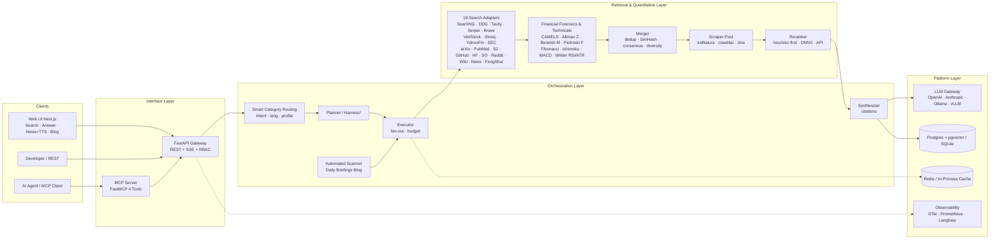

# MetaSearch — AI Meta-Search, Institutional Financial Intelligence & Deep Research Engine

> A multi-source search & quantitative analysis system for AI: **Meta-Search (SearXNG 70+ engines + 14 Vertical Engines) → Crawl & Extract → Dedup/Consensus/Rerank → Synthesize with `[n]` citations**, packaged as REST API + SSE Streaming + MCP Server + Automated Daily Briefings Blog + Web UI.

Tiếng Việt: [README.md](README.md)

Status: **v2.2.0 — Web UI News tab + Vietnamese TTS read-aloud; server-side freshness-window mapping; 2 adversarial audit rounds PASS**:

- **News tab + Vietnamese TTS (`v2.2.0`)**: 6 preset categories (macro economy, finance–stock market, business, tech–AI, banking–monetary, world economy) calling `/v1/search` with `engines=["google_news"]`, `news: true`; **the freshness window is mapped server-side by the backend (`freshness_days` → `when:{n}d`)** (end-anchored ASCII guard never duplicates an operator; the client only sends structured params, never engine operators). Read-aloud via the Web Speech API (the OS voice stack, free, zero backend egress) for answers + whole digests/each news item; the UI truthfully reports whether the voice in use is **local** (stays on-device) or **online** (sent to the TTS vendor). `safeHref()` wraps every href coming from payloads. Details: [docs/16-web-ui-news-tts.md](docs/16-web-ui-news-tts.md).
- **Process hardening (`v2.2.0`)**: the pre-commit gate verifies `api/uv.lock` matches the `pyproject.toml` version (fail-closed); `clean_workspace` never deletes local runtime data (`api/*.db*`, `*.retention`, `api/.env.*`) and never crashes on files locked by a local process; CI adds `npm audit` over dev deps too, plus vitest (16 tests) in the 3-OS frontend matrix.
- **Multi-source FA, eliminating the single-source weakness (`v2.1.0`)**: **direct** adapters for SSI (OHLCV), TCBS (ratios), FireAnt (financial statements, JWT `FA_FIREANT_TOKEN`) — no vnstock/wrapper; breaker-gated `FAAggregator` fan-out with 0.5% cross-validation, and when all sources fail it returns empty fields + `missing_fields` (never fabricates); `VietStockAdapter` falls back concurrently VNDIRECT→SSI, Simplize→TCBS/FireAnt, with provenance recording the real source. Details: [docs/15-fa-sources-plan.md](docs/15-fa-sources-plan.md).
- **Ready for external systems (`v2.0.0`)**: security, data integrity, load, observability, operations, CI:
  - `/v1/context` returns only `chunks` + `sources` by default (opt in via `include`); BYO LLM off by default; per-API-key data isolation; some routes admin-only; SuperAgent off by default.
  - No estimated financial figures or static tables in the runtime; every result and chunk carries source marks (`source_url`, `as_of`) and timestamps.
  - Per-request budgets, admission control, single-flight, shared HTTP layer, CPU off the event loop.
  - Metrics + alerts, bounded queue for DB writes, retention, meaningful `/readyz`, Lite runs Alembic.
  - Lite on Windows as a service (`scripts/windows/`), with Win32_Process command-line checks to eliminate PID-reuse collisions after incidents/reboots; integration contract in `docs/15-integration-guide.md`.
  - All 13 deep-audit findings F1–F13 remediated (durable LLM Council verdict storage, retention cycle, import optimization).
  - CI: `uv` lockfile, mypy (`app/core`, `app/api`), coverage ≥ 84%, gitleaks, promtool, nightly.
  - Measured on harness: search c=1 p95 197 ms (was 875 ms), c=20 0% errors (was 100%), Lite context c=10 0% errors (was 100%). Not yet measured on real Postgres/Redis/SearXNG, Linux, or long soaks.
- **Financial Data Integrity & Real Market Grounding (`v1.3.1`)**:
  - Removed 100% of simulated `sin/cos` candle series; strict **Zero-Hallucination & Grounded Data** policy.
  - Direct real OHLCV candles from the **VNDIRECT dchart TradingView Feed** for 1,518 Vietnamese tickers (HSX, HNX, UPCOM; universe `app/retrieval/data/vn_tickers.json`, with `as_of` date) and market indices (`VNINDEX`, `VN30`).
  - Real fundamentals from the **Simplize API** via the dynamic `_build_dynamic_company_financials` algorithm.
  - `published_at` timestamps normalized from real EOD candle dates and financial-statement update dates; fabricating `datetime.now(UTC)` is strictly forbidden.
  - `_VIET_STOCK_STOP_WORDS` filter prevents injecting ticker symbols into generic market queries.
  - Completed a **3-Round Expert Audit** (Solution Architect, Financial Quant / BA, QA/Security/Perf), all tests green at that version, 7 Quality Gates passed.
- **Autonomous Super-Agent Engine (`v1.3.0`)**: distilled from the **`deepseek-ai/dsh-superagent-prototype`** architecture on top of MetaSearch:
  - **Router–Worker Decoupling (`app.orchestration.superagent.router`)**: a central `SuperAgentRouter` owns the ticket queue, decoupled from isolated `IsolatedSuperAgentWorker` compute workers — solving the human attention bottleneck.
  - **"Quiet Autonomy" & Human Escalation**: the agent silently executes multi-step ReAct and only surfaces finished artifacts (`SuperAgentArtifact`) or high-risk situations needing a human decision (`EscalationRequest`).
  - **Observe Mode (Shadow Evaluation)**: shadow planning/assessment that consumes no live API quota; auto-triggered by webhooks/events.
  - **Proactive Event Ingestion (`app.orchestration.superagent.events`)**: listens to real-time event streams (new financial statements, market news, CVE security alerts, GitHub issues) to auto-activate domain tickets.
  - **Watchdog Supervisor & Circuit Breaker (`app.orchestration.superagent.watchdog`)**: monitors worker heartbeats, trips the circuit and recovers on hung tasks, latency breaches, or token bursts (`TOKEN_BURST`).
- **Multi-Platform Matrix CI on every commit (`v1.2.1`)**: GitHub Actions runs in parallel on **Windows (`windows-latest`), macOS (`macos-latest`), and Linux (`ubuntu-latest`)** with automated jobs (backend tests, frontend build, release pipeline gate, Docker smoke test) on every commit and PR.
- **Cross-Platform Automatic Pre-Commit Hook**: `.githooks/pre-commit` auto-detects the Python runtime (`.venv/Scripts/python.exe`, `.venv/bin/python3`, PATH `python3/python`), `chmod +x` on Unix, and enforces the quality gates (lockfile check first) before allowing any commit.
- **19 Search Engines** (5 general/keyed: `searxng`, `ddg`, `tavily`, `serper`, `brave` + **14 vertical**: `viet_stock`, `stooq`, `yahoo_finance`, `sec_edgar`, `fengshui`, `google_news`, `arxiv`, `pubmed`, `semanticscholar`, `github`, `huggingface`, `stackoverflow`, `reddit`, `wikipedia`) with **Smart Category Routing** that auto-activates the right verticals.
- **Multi-Endpoint LLM Council & Anonymous Cross-Review**: calls many free LLM endpoints concurrently (`openrouter/free`, `pollinations`, `groq`, `gemini`, `nvidia_nim`, `cerebras`, `sambanova`), anonymized as `Candidate A, B, C...` so models peer-review each other on domain rubrics without bias, combining a deterministic audit score (`deterministic_score` 40%) and peer score (`peer_score` 60%) for the Chairman's final verdict.
- **Dream-RSI (Recursive Self-Improvement via Replay World)**: stores verdict trajectories in a **Replay Buffer**, computes UCB1 exploration scores, replays historical queries in a simulated world (Dream Replay) to evolve council-selection policy and per-domain temperature.
- **Extended Free-LLM Catalog (20 presets)** from [nejib1/Free-LLM](https://github.com/nejib1/Free-LLM) & [awesome-freellm-apis](https://github.com/open-free-llm-api/awesome-freellm-apis), plus the OpenRouter Free Router ($0/M) and BYO-LLM.
- **Universal Multi-Domain Deep Intelligence**: deep domain assessment across verticals with **Finance & Financial-Statement Forensics (`financial`)** as the **flagship pilot** plus 7 packs (`biomedical_health`, `technology_ai`, `academic_research`, `legal_macro_policy`, `eastern_metaphysics`, `news_geopolitics`, `general_discovery`).
- **Industry-Specific Financial Forensics (`financial_forensics.py`)**: branch by industry — **Banking (CAMELS / Basel II-III: CAR, NPL, Group-2 loans, LLR, NIM, CASA, LDR, CIR)**, **Brokerage (Margin/collateral vs 200% cap, FVTPL/HTM/AFS, capital adequacy)**, **Real Estate & Industrial Parks (advances from buyers / unbilled, inventory/assets)**, **Manufacturing (debt structure, DSO, CFO/Net Income)** plus **Altman Z-Score**, **Beneish M-Score**, **Piotroski F-Score (9 criteria)**.
- **Quantitative Technical Analysis (`technical_analysis.py`)**: **Fibonacci Retracement & Golden Pocket (`61.8%–65.0%`) + Extensions (`127.2%`, `261.8%`)**, **Ichimoku Kinko Hyo (Tenkan/Kijun/Senkou A-B/Chikou Span)**, **true EMA-based MACD**, **Wilder's RSI & 2x ATR Trailing Stop**, **Stochastic (`%K`, `%D`)**, **Multi-EMA Ribbon (`20/50/200`)**, **linear regression channel ±2σ ($R^2$)**, **8 chart patterns**, and a **Custom Indicator Query Parser** (`RSI 9`, `MACD 8 21 5`, `Bollinger 15 2.5`...).
- **Strict Pre-Commit & Release Process**: the mandatory `.githooks/pre-commit` hook blocks any commit that fails a gate (lockfile check runs first); **770 backend tests + 16 frontend tests (vitest) PASS**, `ruff` 0 issues, `bandit` 0 security issues, clean Next.js 15 build, CI 13/13 jobs green across 3 OS. Full design in [docs/](docs/), detailed plan in [docs/12-roadmap-plan.md](docs/12-roadmap-plan.md).

---

## 1. What problem does MetaSearch solve?

| Real-world problem | How MetaSearch handles it |
|---|---|
| LLM hallucinations, stale knowledge | Every answer is synthesized from real web pages & reports with **mandatory `[n]` citations** mapped back to sources; citations are validated after generation |
| One search engine = one point of view | Concurrent fan-out to **70+ engines** via SearXNG + **14 vertical adapters** (VN/global finance, SEC filings, PubMed biomedicine, arXiv/S2 academia, GitHub/SO/HF code, Google News, Ba Trach feng shui) |
| Stock analysis that only reads raw ratios (P/E, ROE) | **Industry-specific financial forensics** (banking CAMELS, brokerage margin/FVTPL, real-estate unbilled bookings, Altman Z, Beneish M, Piotroski F) combined with **quantitative technicals** (Fibonacci Golden Pocket, Ichimoku Cloud, true EMA MACD, Wilder's RSI/ATR, ±2σ regression channel, 8 chart patterns) |
| Web content full of HTML/JS/ads/CAPTCHA junk | Extraction pipeline (`trafilatura` → `crawl4ai` → `Jina Reader`) with SSRF IP-pinning & anti-challenge escalation turns any URL into **clean LLM-ready Markdown** |
| Duplicated, irrelevant results | Canonical URL + 64-bit SimHash dedup → consensus scoring + curated domain authority → **heuristic-first rerank (0 ms)**, optional int8 ONNX or API rerank |
| AI agents need a search tool | **MCP Server** with 4 tools: `web_search`, `web_scrape`, `web_search_and_scrape`, `deep_research` (stdio + HTTP) |
| Monthly search API costs | Self-host SearXNG or run the **Lite Profile** (keyless DuckDuckGo + SQLite + keyless Jina) = **$0 for search**, API ~100 MB RAM |

## 2. Architecture on one page



Full details: [docs/02-system-architecture.md](docs/02-system-architecture.md) · stage-by-stage pipeline: [docs/03-search-pipeline.md](docs/03-search-pipeline.md)

## 3. Quick Start

### Lite profile — NO Docker needed (low-end machine, API ~100 MB RAM, v0.6.0+)

```bash
git clone https://github.com/hunglinhpt/MetaSearch.git
cd MetaSearch/api
python -m venv .venv
.venv/Scripts/python.exe -m pip install -e ".[dev]"     # Windows; Linux: .venv/bin/pip
cp ../deploy/.env.lite.example .env   # DuckDuckGo keyless + SQLite + Jina keyless + 14 vertical engines
.venv/Scripts/python.exe -m uvicorn app.main:app --port 8000
# Swagger: http://localhost:8000/docs
```

### Full profile — Docker compose (SearXNG consensus + crawl4ai + pgvector)

```bash
git clone https://github.com/hunglinhpt/MetaSearch.git
cd MetaSearch
cp deploy/.env.example .env          # fill in LLM_API_KEY
docker compose -f deploy/docker-compose.yml up -d
# SearXNG   : http://localhost:8080
# API       : http://localhost:8000/docs
# Web UI    : http://localhost:3000

curl -X POST http://localhost:8000/v1/search \
  -H "Content-Type: application/json" \
  -d '{"query": "Phan tich BCCT phap y va ky thuat Fibonacci Ichimoku co phieu FPT RSI 9", "lang": "vi"}'

# CLI
metasearch search "Phan tich co phieu FPT va VCB"
metasearch answer "Phan tich co phieu FPT va VCB" --stream
```

Web UI: open `http://localhost:3000` — pick a category (Finance & Stocks, News, Programming, Academia & Biomedicine, Feng Shui...) and the **AI Answer** mode (with a Vietnamese read-aloud button), **Search**, the **News** tab (6 economy/finance/tech categories, read-aloud for the whole digest or each item), or the **Daily Briefings & Blog** tab.

## 4. Repository layout

```
MetaSearch/
├── README.md                  ← Vietnamese version
├── README.en.md               ← you are here
├── AGENTS.md                  ← agent onboarding guide (status, conventions, checklist)
├── CHANGELOG.md               ← version history (Keep a Changelog — current v2.2.0)
├── CONTRIBUTING.md            ← setup + workflow + gates guideline
├── docs/                      ← detailed design (16 documents + ADRs)
│   ├── 01-product-requirements.md
│   ├── 02-system-architecture.md
│   ├── 03-search-pipeline.md
│   ├── 04-agents-orchestration.md
│   ├── 05-data-model.md
│   ├── 06-api-spec.md
│   ├── 07-mcp-integration.md
│   ├── 08-deployment.md
│   ├── 09-observability-eval.md
│   ├── 10-security-compliance.md
│   ├── 11-testing-strategy.md
│   ├── 12-roadmap-plan.md     ← detailed Phase 0–5 plan + KPI + verify matrix (source of truth)
│   ├── 13-versioning-and-release.md
│   ├── 15-fa-sources-plan.md  ← 21 vetted VN financial sources + direct SSI/TCBS/FireAnt adapters (v2.1.0)
│   ├── 15-integration-guide.md ← external-system integration contract (v2.0.0)
│   ├── 16-web-ui-news-tts.md  ← News tab + Vietnamese TTS, server-side when:Nd mapping (v2.2.0)
│   └── adr/                   ← Architecture Decision Records
├── api/                       ← FastAPI orchestration + Quantitative Engines
│   ├── app/
│   │   ├── core/              ← auth (API key + RBAC + sliding-window), errors, logging, middleware, metrics
│   │   ├── db/                ← SQLAlchemy dialect-aware models (Postgres+pgvector & SQLite)
│   │   ├── api/               ← ops (/healthz, /readyz, /metrics) + v1 (search, answer, scrape, research, digests, engines, queries, ops_status)
│   │   ├── retrieval/         ← 19 adapters, financial_forensics.py, technical_analysis.py, registry, merger, scoring, simhash, reranker
│   │   ├── extraction/        ← ssrf, pinning, robots, scraper (trafilatura→crawl4ai→jina), chunker
│   │   ├── orchestration/     ← pipeline (search+answer), research (Harness² 8 profiles), research_jobs, scheduler (Daily Briefings), persist, engine_store
│   │   ├── mcp/               ← FastMCP server + REST client (4 tools, stdio + HTTP)
│   │   └── llm/               ← gateway streaming, prompts, citations, embeddings, tokens, langfuse
│   ├── alembic/versions/      ← migrations (Postgres + pgvector / SQLite auto-bootstrap)
│   ├── evals/golden.json      ← 40 golden evaluation queries across domains (EN + VI)
│   ├── scripts/               ← eval_run.py (--judge-faithfulness) + perf_load.py
│   ├── tests/                 ← 770 tests (integration gated by METASEARCH_INTEGRATION=1)
│   └── pyproject.toml
├── frontend/                  ← Next.js 15 + React 19 (streaming Web UI + category chips + News tab + TTS + blog reader)
│   ├── app/ · lib/api.ts      ← SSE client + ApiError + Digests API + safeHref
│   ├── lib/tts.ts             ← Vietnamese TTS via Web Speech API (+ vitest tests)
│   ├── components/NewsPanel.tsx ← News tab: 6 categories + read digest/each item
│   └── package.json
├── deploy/
│   ├── docker-compose.yml     ← full stack + observability profile
│   ├── searxng/ · prometheus/ · grafana/ · k6/
│   └── .env.example · .env.lite.example
├── scripts/                   ← release.py (pre-commit gate + release) · guard_local_data.py
├── .githooks/pre-commit       ← mandatory gate: uv.lock check → ruff → bandit → E2E → full pytest
└── .github/workflows/ci.yml   ← CI matrix on 3 OS: backend + frontend (vitest, npm audit incl. dev) + pipeline gate + gitleaks/promtool/docker smoke
```

## 5. Documentation map

| Document | Answers |
|---|---|
| [01 Product Requirements](docs/01-product-requirements.md) | Who uses it, for what, acceptance criteria? |
| [02 System Architecture](docs/02-system-architecture.md) | Layers, components, data flow, tech stack, 16 GB hardware profile? |
| [03 Search Pipeline](docs/03-search-pipeline.md) | How does one query pass through 11 stages, latency budget? |
| [04 Agents Orchestration](docs/04-agents-orchestration.md) | Planner/Executor, deep research loop, Harness² profiles, budget control? |
| [05 Data Model](docs/05-data-model.md) | Postgres/SQLite schema, Redis cache, vector, retention? |
| [06 API Spec](docs/06-api-spec.md) | REST/SSE endpoints (`/v1/search`, `/v1/answer`, `/v1/research`, `/v1/digests`, `/v1/engines`), error model? |
| [07 MCP Integration](docs/07-mcp-integration.md) | Tools for AI agents, contract, call examples? |
| [08 Deployment](docs/08-deployment.md) | Lite profile (no Docker) vs Docker Compose dev 16 GB / prod VPS? |
| [09 Observability & Eval](docs/09-observability-eval.md) | Traces/metrics/logs, 40 golden queries + faithfulness judge? |
| [10 Security & Compliance](docs/10-security-compliance.md) | SSRF IP-pinning, admin RBAC, robots.txt, rate limit, secrets? |
| [11 Testing Strategy](docs/11-testing-strategy.md) | Test strategy, 770 backend + 16 frontend tests, golden set, citation accuracy measurement? |
| [12 Roadmap & Plan](docs/12-roadmap-plan.md) | **Detailed Phase 0–5 plan, KPI, risks & mitigations, post-v2.0.0 version status** |
| [13 Versioning & Release](docs/13-versioning-and-release.md) | **SemVer rules, Quality Gates, automated release script & CI/CD** |
| [15 FA Sources Plan](docs/15-fa-sources-plan.md) | 21 vetted VN financial data sources; direct SSI/TCBS/FireAnt adapters, `FAAggregator` cross-validation (v2.1.0)? |
| [15 Integration Guide](docs/15-integration-guide.md) | Contract for external systems: auth, rate limit, error model, Lite on Windows as a service (v2.0.0)? |
| [16 Web UI News + TTS](docs/16-web-ui-news-tts.md) | 6-category News tab + Vietnamese TTS; server-side `freshness_days`→`when:Nd`; voice privacy policy (v2.2.0)? |

## 6. Standing on the shoulders of giants

MetaSearch does not reinvent the wheel — this design distills the best of leading open-source systems:

| Reference | What MetaSearch borrows |
|---|---|
| [assafelovic/gpt-researcher](https://github.com/assafelovic/gpt-researcher) | **Planner & Executor** pattern: split big questions → sub-queries, fan out in parallel, synthesize with sources; `retrievers/` + `scraper/` abstractions |
| [ItzCrazyKns/Perplexica (Vane)](https://github.com/ItzCrazyKns/Perplexica) | **SearXNG** as unified search API; chunk filtering before the LLM; streaming answers |
| [rashadphz/farfalle](https://github.com/rashadphz/farfalle) | Clean layer separation (search/scraper/LLM provider), flexible cloud ↔ local LLM swap |
| [miurla/morphic](https://github.com/miurla/morphic) · [scira-ai/scira](https://github.com/scira-ai/scira) | **Generative UI**: card/table result rendering, multi-tool calling |
| [searxng/searxng](https://github.com/searxng/searxng) | **The heart of meta-search**: 70+ engines, dedup, consensus ranking, JSON output |
| [unclecode/crawl4ai](https://github.com/unclecode/crawl4ai) | LLM-dedicated extraction: strips ads/menus, outputs Markdown, JS rendering |
| [jina-ai/reader](https://github.com/jina-ai/reader) | Fallback extractor for hard pages (`r.jina.ai` when self-extraction fails) |
| [siosig/searxng-crawl4ai-mcp](https://github.com/siosig/searxng-crawl4ai-mcp) | Pattern for combining SearXNG + Crawl4AI into a single **MCP tool** `web_search_and_scrape` |
| [chen150450/multi-search-aggregator](https://github.com/chen150450/multi-search-aggregator) | **Pluggable engine registry + hot config**; multi-signal scoring; per-engine SSE progress (`engine_done`); graceful degradation |

What makes MetaSearch **different**: a thin orchestration layer on top of 4 "giants" — **SearXNG** (meta-search), **crawl4ai** (JS extraction), **trafilatura** (static extraction), **FastMCP** (agent interface) — combined with a deep **Financial Forensics (CAMELS / Altman Z / Beneish M / Piotroski F)** and **Quantitative Technical Analysis (Fibonacci / Ichimoku / MACD / Wilder's RSI & ATR)** layer. Strategy details: [ADR-007](docs/adr/ADR-007-giants-first.md).

## 7. License & Contributing

This project is released under the **GNU General Public License v3.0 (GPL-3.0-or-later)**.

We warmly welcome community contributions (issues, feature requests, pull requests)! See [CONTRIBUTING.md](CONTRIBUTING.md) for the development setup, workflow, and quality gates before submitting.

*Note: all web scraping and searching must respect `robots.txt` and the terms of service of the source platforms (see [docs/10-security-compliance.md](docs/10-security-compliance.md)).*
