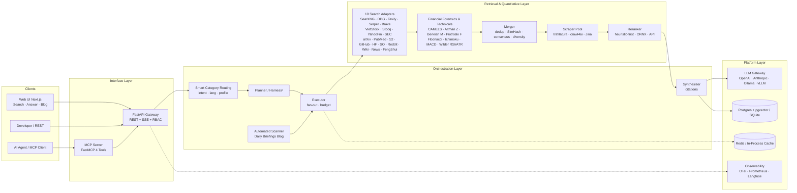

# MetaSearch — AI Meta-Search, Institutional Financial Intelligence & Deep Research Engine

> Hệ thống tìm kiếm đa nguồn & phân tích định lượng phục vụ AI: **Meta-Search (SearXNG 70+ engines + 14 Vertical Engines) → Crawl & Extract → Dedup/Consensus/Rerank → Synthesize có trích dẫn `[n]`**, đóng gói thành REST API + SSE Streaming + MCP Server + Automated Daily Briefings Blog + Web UI.

Trạng thái: **v1.0.0 — Institutional Release (Phase 0–5 Hoàn Tất)**:
- **19 Search Engines** (5 General/Keyed: `searxng`, `ddg`, `tavily`, `serper`, `brave` + **14 Vertical Engines**: `viet_stock`, `stooq`, `yahoo_finance`, `sec_edgar`, `fengshui`, `google_news`, `arxiv`, `pubmed`, `semanticscholar`, `github`, `huggingface`, `stackoverflow`, `reddit`, `wikipedia`) kèm cơ chế **Smart Category Routing** tự động kích hoạt chuyên ngành.
- **Thẩm Định Pháp Y BCTC Chuyên Sâu (`financial_forensics.py`)**: Phân nhánh theo đặc thù ngành — **Ngân hàng (CAMELS / Basel II-III: CAR, NPL, Nợ nhóm 2, LLR, NIM, CASA, LDR, CIR)**, **Chứng khoán (Margin/VCSH so với trần 200%, FVTPL/HTM/AFS, Tỷ lệ an toàn tài chính)**, **Bất động sản & KCN (Người mua trả tiền trước / Của để dành, Tồn kho/Tài sản)**, **Sản xuất (Cấu trúc nợ, DSO, CFO/Net Income)** kèm **Altman Z-Score**, **Beneish M-Score**, **Piotroski F-Score (9 tiêu chí)**.
- **Phân Tích Kỹ Thuật Định Lượng (`technical_analysis.py`)**: **Fibonacci Retracement & Golden Pocket (`61.8%–65.0%`) + Extensions (`127.2%`, `261.8%`)**, **Ichimoku Kinko Hyo (Tenkan/Kijun/Senkou A-B/Chikou Span)**, **True EMA-based MACD**, **Wilder's RSI & 2x ATR Trailing Stop**, **Stochastic (`%K`, `%D`)**, **Multi-EMA Ribbon (`20/50/200`)**, **Kênh hồi quy tuyến tính $\pm 2\sigma$ ($R^2$)**, **8 mẫu hình giá/nến**, và **Custom Indicator Query Parser** (`RSI 9`, `MACD 8 21 5`, `Bollinger 15 2.5`...).
- **Deep Research (`Harness²` 8 Profiles) + MCP Server (4 Tools) + Automated Scanner & Daily Briefings Blog (`/v1/digests`)**.
- **Chất lượng kiểm định**: **333 unit tests PASS**, `ruff` 0 lỗi, `bandit` 0 lỗi bảo mật, Next.js 15 build sạch, 40 Golden Evals (`--judge-faithfulness`). Thiết kế đầy đủ nằm trong [docs/](docs/), plan chi tiết ở [docs/12-roadmap-plan.md](docs/12-roadmap-plan.md).

---

## 1. MetaSearch giải quyết vấn đề gì?

| Vấn đề thực tế | Cách MetaSearch xử lý |
|---|---|
| LLM bị "ảo giác", kiến thức cũ | Mọi câu trả lời được tổng hợp từ trang web & báo cáo thật, **bắt buộc có trích dẫn `[n]`** map ngược về nguồn; citation được validate sau khi sinh |
| Một search engine = một góc nhìn | Fan-out đồng thời **70+ engines** qua SearXNG + **14 Vertical Adapters** chuyên sâu (Tài chính chứng khoán VN/Quốc tế, Pháp lý SEC, Y sinh PubMed, Học thuật arXiv/S2, Code GitHub/SO/HF, Tin tức Google News, Phong thủy Bát Trạch) |
| Phân tích cổ phiếu chỉ đọc chỉ số thô (P/E, ROE) | Bóc tách **Pháp y BCTC theo ngành** (CAMELS ngân hàng, Margin/FVTPL chứng khoán, Unbilled Bookings BĐS/KCN, Altman Z, Beneish M, Piotroski F) kết hợp **Kỹ thuật định lượng** (Fibonacci Golden Pocket, Ichimoku Cloud, True EMA MACD, Wilder's RSI/ATR, Kênh hồi quy $\pm 2\sigma$, 8 mẫu hình giá/nến) |
| Nội dung web đầy rác HTML/JS/ads/CAPTCHA | Extraction pipeline (`trafilatura` → `crawl4ai` → `Jina Reader`) kèm SSRF IP-pinning & Anti-challenge escalation biến URL → **Markdown sạch tối ưu cho context LLM** |
| Kết quả trùng lặp, kém liên quan | Canonical URL + SimHash 64-bit dedup → consensus scoring + curated domain authority → **rerank heuristic-first (0ms)**, tuỳ chọn int8 ONNX hoặc API rerank |
| AI Agent cần công cụ tìm kiếm | **MCP Server** với 4 tool: `web_search`, `web_scrape`, `web_search_and_scrape`, `deep_research` (stdio + HTTP) |
| Chi phí API search hàng tháng | Self-host SearXNG hoặc chạy **Lite Profile** (DuckDuckGo keyless + SQLite + Jina keyless) = **$0 cho phần search**, API chỉ ~100MB RAM |

## 2. Kiến trúc một trang



Chi tiết đầy đủ: [docs/02-system-architecture.md](docs/02-system-architecture.md) · Pipeline từng stage: [docs/03-search-pipeline.md](docs/03-search-pipeline.md)

## 3. Quick Start

### Lite profile — KHÔNG cần Docker (máy yếu, API ~100MB RAM, v0.6.0+)

```bash
git clone https://github.com/hunglinhpt/MetaSearch.git
cd MetaSearch/api
python -m venv .venv
.venv/Scripts/python.exe -m pip install -e ".[dev]"     # Windows; Linux: .venv/bin/pip
cp ../deploy/.env.lite.example .env   # DuckDuckGo keyless + SQLite + Jina keyless + 14 Vertical Engines
.venv/Scripts/python.exe -m uvicorn app.main:app --port 8000
# Swagger: http://localhost:8000/docs
```

### Full profile — Docker compose (SearXNG consensus + crawl4ai + pgvector)

```bash
git clone https://github.com/hunglinhpt/MetaSearch.git
cd MetaSearch
cp deploy/.env.example .env          # điền LLM_API_KEY
docker compose -f deploy/docker-compose.yml up -d
# SearXNG   : http://localhost:8080
# API       : http://localhost:8000/docs
# Web UI    : http://localhost:3000

curl -X POST http://localhost:8000/v1/search \
  -H "Content-Type: application/json" \
  -d '{"query": "Phân tích BCTC pháp y và kỹ thuật Fibonacci Ichimoku cổ phiếu FPT RSI 9", "lang": "vi"}'

# CLI
metasearch search "Phân tích cổ phiếu FPT và VCB"
metasearch answer "Phân tích cổ phiếu FPT và VCB" --stream
```

Web UI: mở `http://localhost:3000` — chọn chuyên mục (Tài chính & Cổ phiếu, Tin tức, Lập trình, Học thuật & Y sinh, Phong thủy...) và chế độ **✨ Trả lời AI**, **🔎 Tìm kiếm**, hoặc chuyển sang tab **📰 Bản Tin & Blog Chuyên Sâu**.

## 4. Cấu trúc repo

```
MetaSearch/
├── README.md                  ← bạn đang ở đây
├── AGENTS.md                  ← hướng dẫn AI agent nhận việc (trạng thái, quy ước, checklist)
├── CHANGELOG.md               ← lịch sử version (Keep a Changelog — v1.0.0)
├── CONTRIBUTING.md            ← guideline setup + workflow + gate
├── docs/                      ← thiết kế chi tiết (12 tài liệu + 8 ADR)
│   ├── 01-product-requirements.md
│   ├── 02-system-architecture.md
│   ├── 03-search-pipeline.md
│   ├── 04-agents-orchestration.md
│   ├── 05-data-model.md
│   ├── 06-api-spec.md
│   ├── 07-mcp-integration.md
│   ├── 08-deployment.md
│   ├── 09-observability-eval.md
│   ├── 10-security-compliance.md
│   ├── 11-testing-strategy.md
│   ├── 12-roadmap-plan.md     ← plan chi tiết Phase 0–5 (gồm KPI + verify matrix)
│   └── adr/                   ← 8 Architecture Decision Records
├── api/                       ← FastAPI orchestration + Quantitative Engines
│   ├── app/
│   │   ├── core/              ← auth (API key + RBAC + sliding-window), errors, logging, middleware, metrics
│   │   ├── db/                ← SQLAlchemy dialect-aware models (Postgres+pgvector & SQLite)
│   │   ├── api/               ← ops (/healthz, /readyz, /metrics) + v1 (search, answer, scrape, research, digests, engines, queries, ops_status)
│   │   ├── retrieval/         ← 19 adapters, financial_forensics.py, technical_analysis.py, registry, merger, scoring, simhash, reranker
│   │   ├── extraction/        ← ssrf, pinning, robots, scraper (trafilatura→crawl4ai→jina), chunker
│   │   ├── orchestration/     ← pipeline (search+answer), research (Harness² 8 profiles), research_jobs, scheduler (Daily Briefings), persist, engine_store
│   │   ├── mcp/               ← FastMCP server + REST client (4 tools, stdio + HTTP)
│   │   └── llm/               ← gateway streaming, prompts, citations, embeddings, tokens, langfuse
│   ├── alembic/versions/      ← migrations (Postgres + pgvector / SQLite auto-bootstrap)
│   ├── evals/golden.json      ← 40 golden evaluation queries đa miền (EN + VI)
│   ├── scripts/               ← eval_run.py (--judge-faithfulness) + perf_load.py
│   ├── tests/                 ← 333 unit tests (+ 7 integration tests gated)
│   └── pyproject.toml
├── frontend/                  ← Next.js 15 + React 19 (Web UI streaming + Category Chips + Markdown Table + Blog Reader)
│   ├── app/ · lib/api.ts      ← SSE client + ApiError + Digests API
│   └── package.json
├── deploy/
│   ├── docker-compose.yml     ← stack đầy đủ + profile observability
│   ├── searxng/ · prometheus/ · grafana/ · k6/
│   └── .env.example · .env.lite.example
└── .github/workflows/ci.yml   ← CI: lint + unit test + security scan + build
```

## 5. Bản đồ tài liệu

| Tài liệu | Trả lời câu hỏi |
|---|---|
| [01 Product Requirements](docs/01-product-requirements.md) | Ai dùng, dùng để làm gì, tiêu chí chấp nhận? |
| [02 System Architecture](docs/02-system-architecture.md) | Các tầng, component, luồng dữ liệu, công nghệ, hardware profile 16GB? |
| [03 Search Pipeline](docs/03-search-pipeline.md) | 1 câu hỏi đi qua 11 stage như thế nào, latency budget? |
| [04 Agents Orchestration](docs/04-agents-orchestration.md) | Planner/Executor, Deep Research loop, Harness² profiles, budget control? |
| [05 Data Model](docs/05-data-model.md) | Schema Postgres/SQLite, cache Redis, vector, retention? |
| [06 API Spec](docs/06-api-spec.md) | Endpoint REST/SSE (`/v1/search`, `/v1/answer`, `/v1/research`, `/v1/digests`, `/v1/engines`), error model? |
| [07 MCP Integration](docs/07-mcp-integration.md) | Tool cho AI Agent, contract, ví dụ gọi? |
| [08 Deployment](docs/08-deployment.md) | Lite profile (không Docker) vs Docker Compose dev 16GB / prod VPS? |
| [09 Observability & Eval](docs/09-observability-eval.md) | Trace/metrics/log, eval 40 golden queries + faithfulness judge? |
| [10 Security & Compliance](docs/10-security-compliance.md) | SSRF IP-pinning, RBAC admin, robots.txt, rate limit, secrets? |
| [11 Testing Strategy](docs/11-testing-strategy.md) | Test strategy, 333 unit tests, golden set, đo citation accuracy? |
| [12 Roadmap & Plan](docs/12-roadmap-plan.md) | **Plan chi tiết Phase 0–5 (v1.0.0), KPI, rủi ro & mitigation** |

## 6. Đứng trên vai người khổng lồ

MetaSearch không phát minh lại bánh xe — thiết kế này tổng hợp tinh hoa từ các hệ thống mã nguồn mở tiêu biểu:

| Nguồn tham khảo | Điều mượn vào MetaSearch |
|---|---|
| [assafelovic/gpt-researcher](https://github.com/assafelovic/gpt-researcher) | Mẫu **Planner & Executor**: tách câu hỏi lớn → sub-queries, gọi song song, tổng hợp có dẫn nguồn; abstraction `retrievers/` + `scraper/` |
| [ItzCrazyKns/Perplexica (Vane)](https://github.com/ItzCrazyKns/Perplexica) | Tích hợp **SearXNG** làm unified search API; lọc đoạn văn trước khi đưa vào LLM; streaming answer |
| [rashadphz/farfalle](https://github.com/rashadphz/farfalle) | Tách lớp sạch (search/scraper/LLM provider), hoán đổi linh hoạt cloud ↔ local LLM |
| [miurla/morphic](https://github.com/miurla/morphic) · [scira-ai/scira](https://github.com/scira-ai/scira) | **Generative UI**: hiển thị kết quả dạng thẻ/bảng, multi-tool calling |
| [searxng/searxng](https://github.com/searxng/searxng) | **Trái tim meta-search**: 70+ engines, khử trùng lặp, consensus ranking, xuất JSON |
| [unclecode/crawl4ai](https://github.com/unclecode/crawl4ai) | Extraction dành riêng cho LLM: loại ads/menu, xuất Markdown, JS rendering |
| [jina-ai/reader](https://github.com/jina-ai/reader) | Fallback extractor cho trang khó (dùng `r.jina.ai` khi self-extract thất bại) |
| [siosig/searxng-crawl4ai-mcp](https://github.com/siosig/searxng-crawl4ai-mcp) | Mẫu ghép SearXNG + Crawl4AI thành **MCP tool duy nhất** `web_search_and_scrape` |
| [chen150450/multi-search-aggregator](https://github.com/chen150450/multi-search-aggregator) | **Engine registry pluggable + hot config**; **multi-signal scoring**; SSE per-engine progress (`engine_done`); graceful degradation |

Điểm **khác biệt** của MetaSearch: orchestration mỏng đứng trên 4 "gã khổng lồ" — **SearXNG** (meta-search), **crawl4ai** (JS extraction), **trafilatura** (static extraction), **FastMCP** (agent interface) — kết hợp cùng tầng **Pháp Y Tài Chính (CAMELS / Altman Z / Beneish M / Piotroski F)** và **Phân Tích Kỹ Thuật Định Lượng (Fibonacci / Ichimoku / MACD / Wilder's RSI & ATR)** chuyên sâu. Chiến lược chi tiết: [ADR-007](docs/adr/ADR-007-giants-first.md).

## 7. License & phạm vi

Repo private — dùng nội bộ. Tuân thủ robots.txt và điều khoản các engine (xem [docs/10-security-compliance.md](docs/10-security-compliance.md)).
