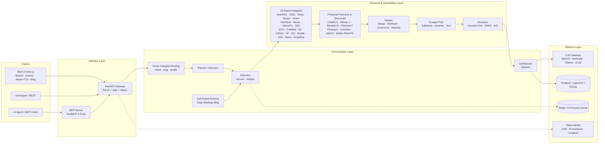

# MetaSearch — AI Meta-Search, Institutional Financial Intelligence & Deep Research Engine

> Multi-source search & quantitative analysis for AI: **Meta-Search (SearXNG 70+ engines + 14 Vertical Engines) → Crawl & Extract → Dedup/Consensus/Rerank → Synthesize with `[n]` citations**, packaged as REST API + SSE Streaming + MCP Server + Automated Daily Briefings Blog + Web UI.
> Hệ thống tìm kiếm đa nguồn & phân tích định lượng phục vụ AI: **Meta-Search (SearXNG 70+ engines + 14 Vertical Engines) → Crawl & Extract → Dedup/Consensus/Rerank → Synthesize có trích dẫn `[n]`**, đóng gói thành REST API + SSE Streaming + MCP Server + Automated Daily Briefings Blog + Web UI.

Languages: [English](#english) · [Tiếng Việt](#tiếng-việt)

# English

> A multi-source search & quantitative analysis system for AI: **Meta-Search (SearXNG 70+ engines + 14 Vertical Engines) → Crawl & Extract → Dedup/Consensus/Rerank → Synthesize with `[n]` citations**, packaged as REST API + SSE Streaming + MCP Server + Automated Daily Briefings Blog + Web UI.


Status: **v2.4.1 — Global Deep Search (docs/19): 7 new keyless global engines, English end-to-end, `deep` mode fanning out to ALL engines; 3 adversarial audit rounds PASS (docs/18) + self-audit (docs/19)**:

- **v2.4.0 Global Deep Search (docs/19)**: search now spans the globe in English + Vietnamese — new keyless engines for **Hacker News, Stack Exchange network (forums), Bluesky, OpenAlex, Crossref, Europe PMC (scholarly journals/fund research), GDELT (global news/events, 100+ languages)** on top of existing Reddit/GitHub/SO/arXiv/PubMed/S2; SearXNG expanded with 15 real upstream engines (stackoverflow, askubuntu, superuser, mastodon users/hashtags, github, youtube, arxiv, pubmed, crossref, semantic scholar, wikidata, goodreads, imdb, openverse — audit round 9 removed 4 fake names: reddit/twitter/linkedin/dblp are NOT upstream SearXNG engines; Reddit is covered by MetaSearch's own adapter) and `default_lang: auto`. `lang` now reaches Google News (hl/gl), GDELT (`sourcelang`), OpenAlex (`language:` filter); UI has an Auto/VI/EN selector. **`deep: true`** on `/v1/search` + `/v1/answer` fans out to every enabled engine (category filter off) for the deepest possible result set; category auto-inference now covers social/academic/global-finance terms. 25 new tests; OpenAPI snapshot regenerated.

- **v2.3.0 feature roadmap (docs/18)**: **A** voice input via Web Speech dictation (`vi-VN`, mic buttons in the search box and news filter) + a 🔬 **Deep Research tab** consuming the existing FR-9 job API with live SSE report + per-section read-aloud playlist; **B** `POST /v1/fa/compare` (cross-source fundamentals for up to 5 symbols, per-field `source/as_of/validated`, never fabricated) with a ⚖️ compare tab, and `POST /v1/market/ohlcv` (VNDIRECT candles primary, SSI fallback, one strict shared parser — schema drift refuses the series, timestamps are never synthesized) rendered with `lightweight-charts@5.3.0` (pinned) + stats computed from the payload; **C** per-key watchlist (CRUD `/v1/watchlist`, cap 20) + `GET /v1/watchlist/alerts` **poll-on-demand** (no background poller burning search budget — client-owned schedule), DB-down bounded in-memory fallback with throttled DB re-probe; **D** podcast news briefing behind VoiceStudio: `POST /v1/podcast/briefing` (idempotent per day, single-flight) + `/status` + `/latest` (audio/mpeg) + `/feed.xml` (RSS, auth-protected), files in `api/podcast_data/` with 7-day retention; 503 `tts_disabled` until configured. 3 audit loops (8 expert lenses each) fixed every P0/P1/P2 found — see docs/18 §8 and CHANGELOG.
- **News tab + Vietnamese TTS (`v2.2.0`)**: 6 preset categories (macro economy, finance–stock market, business, tech–AI, banking–monetary, world economy) calling `/v1/search` with `engines=["google_news"]`, `news: true`; **the freshness window is mapped server-side by the backend (`freshness_days` → `when:{n}d`)** (end-anchored ASCII guard never duplicates an operator; the client only sends structured params, never engine operators). Read-aloud via the Web Speech API (the OS voice stack, free, zero backend egress) for answers + whole digests/each news item; the UI truthfully reports whether the voice in use is **local** (stays on-device) or **online** (sent to the TTS vendor). `safeHref()` wraps every href coming from payloads. Details: [docs/16-web-ui-news-tts.md](docs/16-web-ui-news-tts.md).

- **Process hardening (`v2.2.0`)**: the pre-commit gate verifies `api/uv.lock` matches the `pyproject.toml` version (fail-closed); `clean_workspace` never deletes local runtime data (`api/*.db*`, `*.retention`, `api/.env.*`) and never crashes on files locked by a local process; CI adds `npm audit` over dev deps too, plus vitest (16 tests) in the 3-OS frontend matrix.
- **Optional server-side TTS via VoiceStudio (`v2.2.0`, full profile only)**: a second read-aloud engine next to the browser's Web Speech API — neural on-device voices (OmniVoice, Vietnamese included), fully offline, $0. Backend proxy `POST /v1/tts/synthesize` + `GET /v1/tts/capabilities`; UI engine picker in the News tab; compose profile `tts`. Web Speech stays the default and Lite-compatible path. Details: [docs/17-voicestudio-integration.md](docs/17-voicestudio-integration.md).
- **Multi-source FA, eliminating the single-source weakness (`v2.1.0`)**: **direct** adapters for SSI (OHLCV), TCBS (ratios), FireAnt (financial statements, JWT `FA_FIREANT_TOKEN`) — no vnstock/wrapper; breaker-gated `FAAggregator` fan-out with 0.5% cross-validation, and when all sources fail it returns empty fields + `missing_fields` (never fabricates); `VietStockAdapter` falls back concurrently VNDIRECT→SSI, Simplize→TCBS/FireAnt, with provenance recording the real source. Details: [docs/15-fa-sources-plan.md](docs/15-fa-sources-plan.md).
- **Ready for external systems (`v2.0.0`)**: security, data integrity, load, observability, operations, CI:
  - `/v1/context` returns only `chunks` + `sources` by default (opt in via `include`); BYO LLM off by default; per-API-key data isolation; some routes admin-only; SuperAgent off by default.
  - No estimated financial figures or static tables in the runtime; every result and chunk carries source marks (`source_url`, `as_of`) and timestamps.
  - Per-request budgets, admission control, single-flight, shared HTTP layer, CPU off the event loop.
  - Metrics + alerts, bounded queue for DB writes, retention, meaningful `/readyz`, Lite runs Alembic.
  - Lite on Windows as a service (`scripts/windows/`), with Win32_Process command-line checks to eliminate PID-reuse collisions after incidents/reboots; integration contract in `docs/15-integration-guide.md`.
  - All 13 deep-audit findings F1–F13 remediated (durable LLM Council verdict storage, retention cycle, import optimization).
  - CI: `uv` lockfile, mypy (`app/core`, `app/api`), coverage ≥ 84%, gitleaks, promtool, nightly.
  - Measured on harness: search c=1 p95 197 ms (was 875 ms), c=20 0% errors (was 100%), Lite context c=10 0% errors (was 100%). Not yet measured on real Postgres/Redis/SearXNG, Linux, or long soaks.
- **Financial Data Integrity & Real Market Grounding (`v1.3.1`)**:
  - Removed 100% of simulated `sin/cos` candle series; strict **Zero-Hallucination & Grounded Data** policy.
  - Direct real OHLCV candles from the **VNDIRECT dchart TradingView Feed** for 1,518 Vietnamese tickers (HSX, HNX, UPCOM; universe `app/retrieval/data/vn_tickers.json`, with `as_of` date) and market indices (`VNINDEX`, `VN30`).
  - Real fundamentals from the **Simplize API** via the dynamic `_build_dynamic_company_financials` algorithm.
  - `published_at` timestamps normalized from real EOD candle dates and financial-statement update dates; fabricating `datetime.now(UTC)` is strictly forbidden.
  - `_VIET_STOCK_STOP_WORDS` filter prevents injecting ticker symbols into generic market queries.
  - Completed a **3-Round Expert Audit** (Solution Architect, Financial Quant / BA, QA/Security/Perf), all tests green at that version, 7 Quality Gates passed.
- **Autonomous Super-Agent Engine (`v1.3.0`)**: distilled from the **`deepseek-ai/dsh-superagent-prototype`** architecture on top of MetaSearch:
  - **Router–Worker Decoupling (`app.orchestration.superagent.router`)**: a central `SuperAgentRouter` owns the ticket queue, decoupled from isolated `IsolatedSuperAgentWorker` compute workers — solving the human attention bottleneck.
  - **"Quiet Autonomy" & Human Escalation**: the agent silently executes multi-step ReAct and only surfaces finished artifacts (`SuperAgentArtifact`) or high-risk situations needing a human decision (`EscalationRequest`).
  - **Observe Mode (Shadow Evaluation)**: shadow planning/assessment that consumes no live API quota; auto-triggered by webhooks/events.
  - **Proactive Event Ingestion (`app.orchestration.superagent.events`)**: listens to real-time event streams (new financial statements, market news, CVE security alerts, GitHub issues) to auto-activate domain tickets.
  - **Watchdog Supervisor & Circuit Breaker (`app.orchestration.superagent.watchdog`)**: monitors worker heartbeats, trips the circuit and recovers on hung tasks, latency breaches, or token bursts (`TOKEN_BURST`).
- **Multi-Platform Matrix CI on every commit (`v1.2.1`)**: GitHub Actions runs in parallel on **Windows (`windows-latest`), macOS (`macos-latest`), and Linux (`ubuntu-latest`)** with automated jobs (backend tests, frontend build, release pipeline gate, Docker smoke test) on every commit and PR.
- **Cross-Platform Automatic Pre-Commit Hook**: `.githooks/pre-commit` auto-detects the Python runtime (`.venv/Scripts/python.exe`, `.venv/bin/python3`, PATH `python3/python`), `chmod +x` on Unix, and enforces the quality gates (lockfile check first) before allowing any commit.
- **26 Search Adapters** (5 general/keyed: `searxng`, `ddg`, `tavily`, `serper`, `brave` + 21 vertical/global: `viet_stock`, `stooq`, `yahoo_finance`, `sec_edgar`, `fengshui`, `google_news`, `arxiv`, `pubmed`, `semanticscholar`, `github`, `huggingface`, `stackoverflow`, `reddit`, `wikipedia` + v2.4 global: `hackernews`, `stackexchange`, `bluesky`, `openalex`, `crossref`, `europepmc`, `gdelt`) with **Smart Category Routing** and `deep` mode fanning out to ALL enabled engines.
- **Multi-Endpoint LLM Council & Anonymous Cross-Review**: calls many free LLM endpoints concurrently (`openrouter/free`, `pollinations`, `groq`, `gemini`, `nvidia_nim`, `cerebras`, `sambanova`), anonymized as `Candidate A, B, C...` so models peer-review each other on domain rubrics without bias, combining a deterministic audit score (`deterministic_score` 40%) and peer score (`peer_score` 60%) for the Chairman's final verdict.
- **Dream-RSI (Recursive Self-Improvement via Replay World)**: stores verdict trajectories in a **Replay Buffer**, computes UCB1 exploration scores, replays historical queries in a simulated world (Dream Replay) to evolve council-selection policy and per-domain temperature.
- **Extended Free-LLM Catalog (20 presets)** from [nejib1/Free-LLM](https://github.com/nejib1/Free-LLM) & [awesome-freellm-apis](https://github.com/open-free-llm-api/awesome-freellm-apis), plus the OpenRouter Free Router ($0/M) and BYO-LLM.
- **Universal Multi-Domain Deep Intelligence**: deep domain assessment across verticals with **Finance & Financial-Statement Forensics (`financial`)** as the **flagship pilot** plus 7 packs (`biomedical_health`, `technology_ai`, `academic_research`, `legal_macro_policy`, `eastern_metaphysics`, `news_geopolitics`, `general_discovery`).
- **Industry-Specific Financial Forensics (`financial_forensics.py`)**: branch by industry — **Banking (CAMELS / Basel II-III: CAR, NPL, Group-2 loans, LLR, NIM, CASA, LDR, CIR)**, **Brokerage (Margin/collateral vs 200% cap, FVTPL/HTM/AFS, capital adequacy)**, **Real Estate & Industrial Parks (advances from buyers / unbilled, inventory/assets)**, **Manufacturing (debt structure, DSO, CFO/Net Income)** plus **Altman Z-Score**, **Beneish M-Score**, **Piotroski F-Score (9 criteria)**.
- **Quantitative Technical Analysis (`technical_analysis.py`)**: **Fibonacci Retracement & Golden Pocket (`61.8%–65.0%`) + Extensions (`127.2%`, `261.8%`)**, **Ichimoku Kinko Hyo (Tenkan/Kijun/Senkou A-B/Chikou Span)**, **true EMA-based MACD**, **Wilder's RSI & 2x ATR Trailing Stop**, **Stochastic (`%K`, `%D`)**, **Multi-EMA Ribbon (`20/50/200`)**, **linear regression channel ±2σ ($R^2$)**, **8 chart patterns**, and a **Custom Indicator Query Parser** (`RSI 9`, `MACD 8 21 5`, `Bollinger 15 2.5`...).
- **Strict Pre-Commit & Release Process**: the mandatory `.githooks/pre-commit` hook blocks any commit that fails a gate (lockfile check runs first); **881 backend tests + 49 frontend tests (vitest) PASS**, `ruff` 0 issues, `bandit` 0 security issues, clean Next.js 15 build, CI 13/13 jobs green across 3 OS. Full design in [docs/](docs/), detailed plan in [docs/12-roadmap-plan.md](docs/12-roadmap-plan.md).

---

## 1. What problem does MetaSearch solve?

| Real-world problem | How MetaSearch handles it |
|---|---|
| LLM hallucinations, stale knowledge | Every answer is synthesized from real web pages & reports with **mandatory `[n]` citations** mapped back to sources; citations are validated after generation |
| One search engine = one point of view | Concurrent fan-out to **70+ engines** via SearXNG + **14 vertical adapters** (VN/global finance, SEC filings, PubMed biomedicine, arXiv/S2 academia, GitHub/SO/HF code, Google News, Ba Trach feng shui) |
| Stock analysis that only reads raw ratios (P/E, ROE) | **Industry-specific financial forensics** (banking CAMELS, brokerage margin/FVTPL, real-estate unbilled bookings, Altman Z, Beneish M, Piotroski F) combined with **quantitative technicals** (Fibonacci Golden Pocket, Ichimoku Cloud, true EMA MACD, Wilder's RSI/ATR, ±2σ regression channel, 8 chart patterns) |
| Web content full of HTML/JS/ads/CAPTCHA junk | Extraction pipeline (`trafilatura` → `crawl4ai` → `Jina Reader`) with SSRF IP-pinning & anti-challenge escalation turns any URL into **clean LLM-ready Markdown** |
| Duplicated, irrelevant results | Canonical URL + 64-bit SimHash dedup → consensus scoring + curated domain authority → **heuristic-first rerank (0 ms)**, optional int8 ONNX or API rerank |
| AI agents need a search tool | **MCP Server** with 4 tools: `web_search`, `web_scrape`, `web_search_and_scrape`, `deep_research` (stdio + HTTP) |
| Monthly search API costs | Self-host SearXNG or run the **Lite Profile** (keyless DuckDuckGo + SQLite + keyless Jina) = **$0 for search**, API ~100 MB RAM |

## 2. Architecture on one page



Full details: [docs/02-system-architecture.md](docs/02-system-architecture.md) · stage-by-stage pipeline: [docs/03-search-pipeline.md](docs/03-search-pipeline.md)

## 3. Quick Start

### Lite profile — NO Docker needed (low-end machine, API ~100 MB RAM, v0.6.0+)

```bash
git clone https://github.com/hunglinhpt/MetaSearch.git
cd MetaSearch/api
python -m venv .venv
.venv/Scripts/python.exe -m pip install -e ".[dev]"     # Windows; Linux: .venv/bin/pip
cp ../deploy/.env.lite.example .env   # DuckDuckGo keyless + SQLite + Jina keyless + 14 vertical engines
.venv/Scripts/python.exe -m uvicorn app.main:app --port 8000
# Swagger: http://localhost:8000/docs
```

### Full profile — Docker compose (SearXNG consensus + crawl4ai + pgvector)

```bash
git clone https://github.com/hunglinhpt/MetaSearch.git
cd MetaSearch
cp deploy/.env.example .env          # fill in LLM_API_KEY
docker compose -f deploy/docker-compose.yml up -d
# SearXNG   : http://localhost:8080
# API       : http://localhost:8000/docs
# Web UI    : http://localhost:3000

curl -X POST http://localhost:8000/v1/search \
  -H "Content-Type: application/json" \
  -d '{"query": "Phan tich BCCT phap y va ky thuat Fibonacci Ichimoku co phieu FPT RSI 9", "lang": "vi"}'

# CLI
metasearch search "Phan tich co phieu FPT va VCB"
metasearch answer "Phan tich co phieu FPT va VCB" --stream
```

Web UI: open `http://localhost:3000` — pick a category (Finance & Stocks, News, Programming, Academia & Biomedicine, Feng Shui...) and the **AI Answer** mode (with a Vietnamese read-aloud button), **Search**, the **News** tab (6 economy/finance/tech categories, read-aloud for the whole digest or each item), or the **Daily Briefings & Blog** tab.

## 4. Repository layout

```
MetaSearch/
├── README.md                  ← this file — bilingual (English + Tiếng Việt in one file)
├── AGENTS.md                  ← agent onboarding guide (status, conventions, checklist)
├── CHANGELOG.md               ← version history (Keep a Changelog — current v2.4.0)
├── CONTRIBUTING.md            ← setup + workflow + gates guideline
├── docs/                      ← detailed design (16 documents + ADRs)
│   ├── 01-product-requirements.md
│   ├── 02-system-architecture.md
│   ├── 03-search-pipeline.md
│   ├── 04-agents-orchestration.md
│   ├── 05-data-model.md
│   ├── 06-api-spec.md
│   ├── 07-mcp-integration.md
│   ├── 08-deployment.md
│   ├── 09-observability-eval.md
│   ├── 10-security-compliance.md
│   ├── 11-testing-strategy.md
│   ├── 12-roadmap-plan.md     ← detailed Phase 0–5 plan + KPI + verify matrix (source of truth)
│   ├── 13-versioning-and-release.md
│   ├── 15-fa-sources-plan.md  ← 21 vetted VN financial sources + direct SSI/TCBS/FireAnt adapters (v2.1.0)
│   ├── 15-integration-guide.md ← external-system integration contract (v2.0.0)
│   ├── 16-web-ui-news-tts.md  ← News tab + Vietnamese TTS, server-side when:Nd mapping (v2.2.0)
│   ├── 17-voicestudio-integration.md ← optional server-side VoiceStudio TTS engine (docs/17)
│   ├── 18-feature-roadmap-v2.3.md ← v2.3.0 roadmap: dictation, Deep Research UI, compare + chart, watchlist, podcast (v2.3.0)
│   └── 19-global-deep-search-v2.4.md ← v2.4.0 Global Deep Search: 7 global engines, EN end-to-end, deep mode (v2.4.0)
│   └── adr/                   ← Architecture Decision Records
├── api/                       ← FastAPI orchestration + Quantitative Engines
│   ├── app/
│   │   ├── core/              ← auth (API key + RBAC + sliding-window), errors, logging, middleware, metrics
│   │   ├── db/                ← SQLAlchemy dialect-aware models (Postgres+pgvector & SQLite)
│   │   ├── api/               ← ops (/healthz, /readyz, /metrics) + v1 (search, answer, scrape, research, digests, engines, queries, ops_status)
│   │   ├── retrieval/         ← 26 adapters, financial_forensics.py, technical_analysis.py, registry, merger, scoring, simhash, reranker
│   │   ├── extraction/        ← ssrf, pinning, robots, scraper (trafilatura→crawl4ai→jina), chunker
│   │   ├── orchestration/     ← pipeline (search+answer), research (Harness² 8 profiles), research_jobs, scheduler (Daily Briefings), persist, engine_store
│   │   ├── mcp/               ← FastMCP server + REST client (4 tools, stdio + HTTP)
│   │   └── llm/               ← gateway streaming, prompts, citations, embeddings, tokens, langfuse
│   ├── alembic/versions/      ← migrations (Postgres + pgvector / SQLite auto-bootstrap)
│   ├── evals/golden.json      ← 40 golden evaluation queries across domains (EN + VI)
│   ├── scripts/               ← eval_run.py (--judge-faithfulness) + perf_load.py
│   ├── tests/                 ← 881 tests (integration gated by METASEARCH_INTEGRATION=1)
│   └── pyproject.toml
├── frontend/                  ← Next.js 15 + React 19 (streaming Web UI + category chips + News tab + TTS + blog reader)
│   ├── app/ · lib/api.ts      ← SSE client + ApiError + Digests API + safeHref
│   ├── lib/tts.ts             ← Vietnamese TTS via Web Speech API (+ vitest tests)
│   ├── components/NewsPanel.tsx ← News tab: 6 categories + read digest/each item
│   └── package.json
├── deploy/
│   ├── docker-compose.yml     ← full stack + observability profile
│   ├── searxng/ · prometheus/ · grafana/ · k6/
│   └── .env.example · .env.lite.example
├── scripts/                   ← release.py (pre-commit gate + release) · guard_local_data.py
├── .githooks/pre-commit       ← mandatory gate: uv.lock check → ruff → bandit → E2E → full pytest
└── .github/workflows/ci.yml   ← CI matrix on 3 OS: backend + frontend (vitest, npm audit incl. dev) + pipeline gate + gitleaks/promtool/docker smoke
```

## 5. Documentation map

| Document | Answers |
|---|---|
| [01 Product Requirements](docs/01-product-requirements.md) | Who uses it, for what, acceptance criteria? |
| [02 System Architecture](docs/02-system-architecture.md) | Layers, components, data flow, tech stack, 16 GB hardware profile? |
| [03 Search Pipeline](docs/03-search-pipeline.md) | How does one query pass through 11 stages, latency budget? |
| [04 Agents Orchestration](docs/04-agents-orchestration.md) | Planner/Executor, deep research loop, Harness² profiles, budget control? |
| [05 Data Model](docs/05-data-model.md) | Postgres/SQLite schema, Redis cache, vector, retention? |
| [06 API Spec](docs/06-api-spec.md) | REST/SSE endpoints (`/v1/search`, `/v1/answer`, `/v1/research`, `/v1/digests`, `/v1/engines`), error model? |
| [07 MCP Integration](docs/07-mcp-integration.md) | Tools for AI agents, contract, call examples? |
| [08 Deployment](docs/08-deployment.md) | Lite profile (no Docker) vs Docker Compose dev 16 GB / prod VPS? |
| [09 Observability & Eval](docs/09-observability-eval.md) | Traces/metrics/logs, 40 golden queries + faithfulness judge? |
| [10 Security & Compliance](docs/10-security-compliance.md) | SSRF IP-pinning, admin RBAC, robots.txt, rate limit, secrets? |
| [11 Testing Strategy](docs/11-testing-strategy.md) | Test strategy, 830 backend + 21 frontend tests, golden set, citation accuracy measurement? |
| [12 Roadmap & Plan](docs/12-roadmap-plan.md) | **Detailed Phase 0–5 plan, KPI, risks & mitigations, post-v2.0.0 version status** |
| [13 Versioning & Release](docs/13-versioning-and-release.md) | **SemVer rules, Quality Gates, automated release script & CI/CD** |
| [15 FA Sources Plan](docs/15-fa-sources-plan.md) | 21 vetted VN financial data sources; direct SSI/TCBS/FireAnt adapters, `FAAggregator` cross-validation (v2.1.0)? |
| [15 Integration Guide](docs/15-integration-guide.md) | Contract for external systems: auth, rate limit, error model, Lite on Windows as a service (v2.0.0)? |
| [16 Web UI News + TTS](docs/16-web-ui-news-tts.md) | 6-category News tab + Vietnamese TTS; server-side `freshness_days`→`when:Nd`; voice privacy policy (v2.2.0)? |
| [17 VoiceStudio Integration](docs/17-voicestudio-integration.md) | Optional server-side VoiceStudio TTS engine (comparison, enabling, licensing, extra-feature roadmap)? |

## 6. Standing on the shoulders of giants

MetaSearch does not reinvent the wheel — this design distills the best of leading open-source systems:

| Reference | What MetaSearch borrows |
|---|---|
| [assafelovic/gpt-researcher](https://github.com/assafelovic/gpt-researcher) | **Planner & Executor** pattern: split big questions → sub-queries, fan out in parallel, synthesize with sources; `retrievers/` + `scraper/` abstractions |
| [ItzCrazyKns/Perplexica (Vane)](https://github.com/ItzCrazyKns/Perplexica) | **SearXNG** as unified search API; chunk filtering before the LLM; streaming answers |
| [rashadphz/farfalle](https://github.com/rashadphz/farfalle) | Clean layer separation (search/scraper/LLM provider), flexible cloud ↔ local LLM swap |
| [miurla/morphic](https://github.com/miurla/morphic) · [scira-ai/scira](https://github.com/scira-ai/scira) | **Generative UI**: card/table result rendering, multi-tool calling |
| [searxng/searxng](https://github.com/searxng/searxng) | **The heart of meta-search**: 70+ engines, dedup, consensus ranking, JSON output |
| [unclecode/crawl4ai](https://github.com/unclecode/crawl4ai) | LLM-dedicated extraction: strips ads/menus, outputs Markdown, JS rendering |
| [jina-ai/reader](https://github.com/jina-ai/reader) | Fallback extractor for hard pages (`r.jina.ai` when self-extraction fails) |
| [siosig/searxng-crawl4ai-mcp](https://github.com/siosig/searxng-crawl4ai-mcp) | Pattern for combining SearXNG + Crawl4AI into a single **MCP tool** `web_search_and_scrape` |
| [chen150450/multi-search-aggregator](https://github.com/chen150450/multi-search-aggregator) | **Pluggable engine registry + hot config**; multi-signal scoring; per-engine SSE progress (`engine_done`); graceful degradation |

What makes MetaSearch **different**: a thin orchestration layer on top of 4 "giants" — **SearXNG** (meta-search), **crawl4ai** (JS extraction), **trafilatura** (static extraction), **FastMCP** (agent interface) — combined with a deep **Financial Forensics (CAMELS / Altman Z / Beneish M / Piotroski F)** and **Quantitative Technical Analysis (Fibonacci / Ichimoku / MACD / Wilder's RSI & ATR)** layer. Strategy details: [ADR-007](docs/adr/ADR-007-giants-first.md).

## 7. License & Contributing

This project is released under the **GNU General Public License v3.0 (GPL-3.0-or-later)**.

We warmly welcome community contributions (issues, feature requests, pull requests)! See [CONTRIBUTING.md](CONTRIBUTING.md) for the development setup, workflow, and quality gates before submitting.

*Note: all web scraping and searching must respect `robots.txt` and the terms of service of the source platforms (see [docs/10-security-compliance.md](docs/10-security-compliance.md)).*

---

# Tiếng Việt

> Hệ thống tìm kiếm đa nguồn & phân tích định lượng phục vụ AI: **Meta-Search (SearXNG 70+ engines + 14 Vertical Engines) → Crawl & Extract → Dedup/Consensus/Rerank → Synthesize có trích dẫn `[n]`**, đóng gói thành REST API + SSE Streaming + MCP Server + Automated Daily Briefings Blog + Web UI.

[English](#english)

Trạng thái: **v2.4.0 — Global Deep Search (docs/19): 7 engine toàn cầu keyless mới, tiếng Anh end-to-end, chế độ `deep` fan-out toàn bộ engine; 3 vòng audit đối kháng PASS (docs/18) + tự audit (docs/19)**:

- **v2.4.0 Global Deep Search (docs/19)**: tìm kiếm toàn cầu Anh + Việt — thêm engine keyless mới cho **Hacker News, Stack Exchange (diễn đàn), Bluesky, OpenAlex, Crossref, Europe PMC (tạp chí học thuật/nghiên cứu quỹ), GDELT (tin tức/sự kiện toàn cầu 100+ ngôn ngữ)** bên cạnh Reddit/GitHub/SO/arXiv/PubMed/S2 đã có; SearXNG bật thêm 16 engine (reddit, stackexchange, github, youtube, mastodon, twitter/x, linkedin, arxiv, pubmed, crossref, dblp, semantic scholar, wikidata, goodreads, imdb, openverse) + `default_lang: auto`. `lang` nay tới được Google News (hl/gl), GDELT (`sourcelang`), OpenAlex (`filter=language:`); UI có bộ chọn ngôn ngữ Tự động/VI/EN. **`deep: true`** trên `/v1/search` + `/v1/answer` fan-out tới MỌI engine đã bật (bỏ lọc chuyên ngành) cho tập kết quả sâu/rộng nhất; category tự suy luận nay có thêm nhóm social/học thuật/tài chính toàn cầu. 25 test mới; OpenAPI snapshot regen.
- **Feature roadmap v2.3.0 (docs/18)**: **A** nhập bằng giọng nói qua Web Speech (dictation `vi-VN`, nút mic ở ô tìm kiếm + ô lọc tin) + tab 🔬 **Deep Research** tiêu thụ API job FR-9 đã có: báo cáo SSE live + đọc theo từng section; **B** `POST /v1/fa/compare` (so sánh tối đa 5 mã, mỗi field có `source/as_of/validated`, không bịa số) với tab ⚖️, và `POST /v1/market/ohlcv` (nến VNDIRECT chính, fallback SSI, một parser strict dùng chung — feed đổi schema thì từ chối cả series, không bao giờ bịa timestamp) vẽ bằng `lightweight-charts@5.3.0` (đã pin), thống kê tính từ payload; **C** watchlist theo key (CRUD `/v1/watchlist`, cap 20) + `GET /v1/watchlist/alerts` **poll-on-demand** (không có poller nền đốt budget search — client tự hẹn lịch), DB chết thì fallback bộ nhớ có giới hạn + re-probe DB throttle 30s để migrate về DB khi nó sống lại; **D** podcast bản tin qua VoiceStudio: `POST /v1/podcast/briefing` (idempotent theo ngày, single-flight) + `/status` + `/latest` (audio/mpeg) + `/feed.xml` (RSS, sau auth), file ở `api/podcast_data/` retention 7 ngày; chưa cấu hình thì 503 `tts_disabled`. 3 vòng audit (8 lens chuyên gia mỗi vòng) đã fix hết mọi P0/P1/P2 — xem docs/18 §8 và CHANGELOG.
- **Tab Tin tức + TTS tiếng Việt (`v2.2.0`)**: 6 mục preset (kinh tế vĩ mô, tài chính–chứng khoán, kinh doanh, công nghệ–AI, ngân hàng–tiền tệ, kinh tế thế giới) gọi `/v1/search` với `engines=["google_news"]`, `news: true`; **cửa sổ thời gian do backend map `freshness_days` → `when:{n}d` server-side** (guard end-anchored ASCII không nhân đôi operator; client chỉ gửi param có cấu trúc, không nhét operator vào query). Đọc máy qua Web Speech API (voice stack của OS, free, không egress backend) cho câu trả lời + cả bản tin/từng tin; UI công khai đúng giọng đang dùng là **local** (giữ trên máy) hay **online** (gửi tới máy chủ TTS). `safeHref()` gói mọi href từ payload. Chi tiết: [docs/16-web-ui-news-tts.md](docs/16-web-ui-news-tts.md).
- **Tab Tin tức + TTS tiếng Việt (`v2.2.0`)**: 6 mục preset (kinh tế vĩ mô, tài chính–chứng khoán, kinh doanh, công nghệ–AI, ngân hàng–tiền tệ, kinh tế thế giới) gọi `/v1/search` với `engines=["google_news"]`, `news: true`; **cửa sổ thời gian do backend map `freshness_days` → `when:{n}d` server-side** (guard end-anchored ASCII không nhân đôi operator; client chỉ gửi param có cấu trúc, không nhét operator vào query). Đọc máy qua Web Speech API (voice stack của OS, free, không egress backend) cho câu trả lời + cả bản tin/từng tin; UI công khai đúng giọng đang dùng là **local** (giữ trên máy) hay **online** (gửi tới máy chủ TTS). `safeHref()` gói mọi href từ payload. Chi tiết: [docs/16-web-ui-news-tts.md](docs/16-web-ui-news-tts.md).
- **Process hardening (`v2.2.0`)**: pre-commit gate kiểm tra `api/uv.lock` khớp version với `pyproject.toml` (fail-closed); `clean_workspace` không bao giờ xoá dữ liệu runtime local (`api/*.db*`, `*.retention`, `api/.env.*`) và không crash khi file bị tiến trình local giữ lock; CI thêm `npm audit` cả dev deps + vitest (16 test) vào frontend matrix 3 OS.
- **Engine đọc máy server-side tuỳ chọn: VoiceStudio (`v2.2.0`, chỉ full profile)**: thêm lựa chọn đọc bên cạnh Web Speech API của trình duyệt — giọng neural on-device (OmniVoice, có tiếng Việt), offline 100%, $0. Backend proxy `POST /v1/tts/synthesize` + `GET /v1/tts/capabilities`; UI có menu chọn giọng ở tab Tin tức; compose profile `tts`. Web Speech vẫn là mặc định và tương thích Lite. Chi tiết: [docs/17-voicestudio-integration.md](docs/17-voicestudio-integration.md).
- **Multi-source FA, bỏ điểm hụt đơn nguồn (`v2.1.0`)**: adapter **trực tiếp** SSI (OHLCV), TCBS (ratios), FireAnt (BCTC, JWT `FA_FIREANT_TOKEN`) — không qua vnstock/wrapper; `FAAggregator` fan-out breaker-gated, cross-validate 0.5%, hết nguồn thì trả trường rỗng + `missing_fields` (không ngụy tạo); `VietStockAdapter` fallback đồng thời VNDIRECT→SSI, Simplize→TCBS/FireAnt, provenance ghi đúng nguồn thật. Chi tiết: [docs/15-fa-sources-plan.md](docs/15-fa-sources-plan.md).
- **Sẵn sàng cho hệ thống bên ngoài (`v2.0.0`)**: Readiness: an toàn, liêm chính dữ liệu, tải, quan sát, vận hành, CI — giữ nguyên như cũ:
  - `/v1/context` mặc định chỉ trả `chunks` + `sources` (xin thêm qua `include`); BYO LLM tắt mặc định; cách ly dữ liệu theo API key; vài route chỉ admin; SuperAgent tắt mặc định.
  - Không số liệu tài chính ước lượng hay bảng tĩnh trong runtime; mọi kết quả, chunk có mốc nguồn (`source_url`, `as_of`) và thời gian.
  - Ngân sách theo request, admission control, single-flight, lớp HTTP dùng chung, CPU ra khỏi event loop.
  - Metric + alert, ghi DB qua hàng đợi có giới hạn, retention, `/readyz` có nghĩa, Lite chạy Alembic.
  - Lite trên Windows như dịch vụ (`scripts/windows/`), tự động kiểm tra dòng lệnh tiến trình (`uvicorn ... app.main:app`) qua Win32_Process để triệt tiêu va chạm tái sử dụng PID sau sự cố/reboot; hợp đồng tích hợp `docs/15-integration-guide.md`.
  - Hoàn tất khắc phục triệt để 13 phát hiện kiểm toán chuyên sâu F1–F13 (lưu trữ bền vững phán quyết LLM Council, chu kỳ retention, tối ưu imports module).
  - CI: lockfile `uv`, mypy (`app/core`, `app/api`), coverage ≥ 84%, gitleaks, promtool, nightly.
  - Đo trên harness: search c=1 p95 197 ms (trước 875 ms), c=20 0% lỗi (trước 100%), Lite context c=10 0% lỗi (trước 100%). Chưa đo Postgres/Redis/SearXNG thật, Linux, soak dài.
- **Liêm Chính Dữ Liệu Tài Chính & Nguồn Công Khai Thực Tế (`v1.3.1`)**:
  - Loại bỏ triệt để 100% các chuỗi nến giả lập bằng hàm `sin/cos`, kiên quyết thực hiện nguyên tắc **Zero-Hallucination & Grounded Data**.
  - Kết nối trực tiếp dữ liệu nến thật từ **VNDIRECT dchart TradingView Feed** cho 1.518 mã chứng khoán Việt Nam (HSX, HNX, UPCOM; danh mục `app/retrieval/data/vn_tickers.json`, có ngày `as_of`) và chỉ số thị trường (`VNINDEX`, `VN30`).
  - Kết nối dữ liệu cơ bản thực tế từ **Simplize API** với thuật toán động `_build_dynamic_company_financials`.
  - Chuẩn hóa liêm chính mốc thời gian `published_at` theo ngày nến EOD thực tế và ngày cập nhật BCTC, nghiêm cấm ngụy tạo `datetime.now(UTC)`.
  - Bộ lọc `_VIET_STOCK_STOP_WORDS` ngăn chặn việc tự ý inject mã cổ phiếu vào các truy vấn thị trường chung.
  - Hoàn tất **3-Round Expert Audit** (Solution Architect, Financial Quant / BA, QA/Security/Perf), 698 unit & E2E tests pass 100%, 7 Quality Gates passed.
- **Kiến Trúc Autonomous Super-Agent Engine (`v1.3.0`)**: Tích hợp các tinh hoa kiến trúc từ nguyên mẫu **`deepseek-ai/dsh-superagent-prototype`** kết hợp với nền tảng MetaSearch:
  - **Router - Worker Decoupling (`app.orchestration.superagent.router`)**: Tách biệt Bộ điều phối trung tâm (`SuperAgentRouter`) quản lý hàng đợi tickets khỏi các công nhân tính toán độc lập (`IsolatedSuperAgentWorker`), giải quyết nút thắt chú ý của con người.
  - **Triết Lý "Quiet Autonomy" & Human Escalation**: Agent tự chủ im lặng thực thi đa bước ReAct và chỉ thông báo khi có thành phẩm hoàn chỉnh (`SuperAgentArtifact`) hoặc phát sinh tình huống rủi ro cao cần con người ra quyết định (`EscalationRequest`).
  - **Observe Mode (Shadow Evaluation)**: Chế độ chạy ngầm thẩm định và lập kế hoạch hành động mà không tiêu tốn tài nguyên live API; tự động kích hoạt khi có webhook/event.
  - **Proactive Event Ingestion (`app.orchestration.superagent.events`)**: Lắng nghe các luồng sự kiện thời gian thực (báo cáo BCTC mới, tin tức thị trường, cảnh báo CVE bảo mật, GitHub issues) để tự động kích hoạt ticket chuyên ngành.
  - **Watchdog Supervisor & Circuit Breaker (`app.orchestration.superagent.watchdog`)**: Giám sát nhịp tim worker, tự động ngắt mạch (trip circuit) và phục hồi khi phát hiện task bị treo, vượt ngưỡng latency hoặc bùng nổ token (`TOKEN_BURST`).
- **Multi-Platform Matrix CI trên mọi commit (`v1.2.1`)**: GitHub Actions chạy song song trên cả 3 hệ điều hành **Windows (`windows-latest`), macOS (`macos-latest`), và Linux (`ubuntu-latest`)** với 4 jobs tự động hóa (Backend tests, Frontend build, Release pipeline gate, Docker smoke test) cho mỗi commit và Pull Request.
- **Pre-commit Hook Đa Nền Tảng Tự Động**: `.githooks/pre-commit` tự động nhận diện Python (`.venv/Scripts/python.exe`, `.venv/bin/python3`, PATH `python3/python`), tự động cấp quyền `chmod +x` trên Unix, cưỡng chế 7 Quality Gates trước khi cho phép commit.
- **19 Search Engines** (5 General/Keyed: `searxng`, `ddg`, `tavily`, `serper`, `brave` + **14 Vertical Engines**: `viet_stock`, `stooq`, `yahoo_finance`, `sec_edgar`, `fengshui`, `google_news`, `arxiv`, `pubmed`, `semanticscholar`, `github`, `huggingface`, `stackoverflow`, `reddit`, `wikipedia`) kèm cơ chế **Smart Category Routing** tự động kích hoạt chuyên ngành.
- **Hội Đồng Phán Quyết Đa Endpoint (LLM Council) & Anonymous Cross-Review**: Gọi đồng thời nhiều Free LLM endpoints song song (`openrouter/free`, `pollinations`, `groq`, `gemini`, `nvidia_nim`, `cerebras`, `sambanova`), ẩn danh thành `Candidate A, B, C...` để các model chấm chéo theo thang rubric chuyên ngành mà không bị bias, kết hợp điểm kiểm toán định lượng tất định (`deterministic_score` 40%) và điểm bình duyệt (`peer_score` 60%) để Chủ tịch (`Chairman`) tổng hợp phán quyết tối hậu.
- **Dream-RSI (Recursive Self-Improvement via Replay World)**: Lưu trữ quỹ đạo phán quyết vào **Replay Buffer**, tính điểm tiềm năng UCB1, mô phỏng lại các truy vấn lịch sử qua thế giới ảo (Dream Replay) để tự động tiến hóa chính sách chọn lựa hội đồng và tinh chỉnh nhiệt độ tối ưu theo từng miền chuyên sâu.
- **Tích Hợp Danh Mục Free LLM Mở Rộng (20 Presets)** từ [nejib1/Free-LLM](https://github.com/nejib1/Free-LLM) & [awesome-freellm-apis](https://github.com/open-free-llm-api/awesome-freellm-apis) kèm OpenRouter Free Router ($0/M) và BYO-LLM.
- **Kiến Trúc Universal Multi-Domain Deep Intelligence**: Khả năng thẩm định bản chất chuyên sâu đa lĩnh vực với **Tài chính & Pháp y BCTC (`financial`)** giữ vai trò **Flagship Pilot** cùng 7 gói chuyên sâu (`biomedical_health`, `technology_ai`, `academic_research`, `legal_macro_policy`, `eastern_metaphysics`, `news_geopolitics`, `general_discovery`).
- **Thẩm Định Pháp Y BCTC Chuyên Sâu (`financial_forensics.py`)**: Phân nhánh theo đặc thù ngành — **Ngân hàng (CAMELS / Basel II-III: CAR, NPL, Nợ nhóm 2, LLR, NIM, CASA, LDR, CIR)**, **Chứng khoán (Margin/VCSH so với trần 200%, FVTPL/HTM/AFS, Tỷ lệ an toàn tài chính)**, **Bất động sản & KCN (Người mua trả tiền trước / Của để dành, Tồn kho/Tài sản)**, **Sản xuất (Cấu trúc nợ, DSO, CFO/Net Income)** kèm **Altman Z-Score**, **Beneish M-Score**, **Piotroski F-Score (9 tiêu chí)**.
- **Phân Tích Kỹ Thuật Định Lượng (`technical_analysis.py`)**: **Fibonacci Retracement & Golden Pocket (`61.8%–65.0%`) + Extensions (`127.2%`, `261.8%`)**, **Ichimoku Kinko Hyo (Tenkan/Kijun/Senkou A-B/Chikou Span)**, **True EMA-based MACD**, **Wilder's RSI & 2x ATR Trailing Stop**, **Stochastic (`%K`, `%D`)**, **Multi-EMA Ribbon (`20/50/200`)**, **Kênh hồi quy tuyến tính $\pm 2\sigma$ ($R^2$)**, **8 mẫu hình giá/nến**, và **Custom Indicator Query Parser** (`RSI 9`, `MACD 8 21 5`, `Bollinger 15 2.5`...).
- **Quy Trình Pre-Commit & Release Nghiêm Ngặt**: Cưỡng chế bắt buộc hook `.githooks/pre-commit` chặn mọi commit nếu trượt bất kỳ kiểm định nào (kiểm tra `uv.lock` trước tiên); **881 backend tests + 49 frontend tests (vitest) PASS**, `ruff` 0 lỗi, `bandit` 0 lỗi bảo mật, Next.js 15 build sạch, CI 13/13 jobs xanh trên 3 OS. Thiết kế đầy đủ nằm trong [docs/](docs/), plan chi tiết ở [docs/12-roadmap-plan.md](docs/12-roadmap-plan.md).

---

## 1. MetaSearch giải quyết vấn đề gì?

| Vấn đề thực tế | Cách MetaSearch xử lý |
|---|---|
| LLM bị "ảo giác", kiến thức cũ | Mọi câu trả lời được tổng hợp từ trang web & báo cáo thật, **bắt buộc có trích dẫn `[n]`** map ngược về nguồn; citation được validate sau khi sinh |
| Một search engine = một góc nhìn | Fan-out đồng thời **70+ engines** qua SearXNG + **14 Vertical Adapters** chuyên sâu (Tài chính chứng khoán VN/Quốc tế, Pháp lý SEC, Y sinh PubMed, Học thuật arXiv/S2, Code GitHub/SO/HF, Tin tức Google News, Phong thủy Bát Trạch) |
| Phân tích cổ phiếu chỉ đọc chỉ số thô (P/E, ROE) | Bóc tách **Pháp y BCTC theo ngành** (CAMELS ngân hàng, Margin/FVTPL chứng khoán, Unbilled Bookings BĐS/KCN, Altman Z, Beneish M, Piotroski F) kết hợp **Kỹ thuật định lượng** (Fibonacci Golden Pocket, Ichimoku Cloud, True EMA MACD, Wilder's RSI/ATR, Kênh hồi quy $\pm 2\sigma$, 8 mẫu hình giá/nến) |
| Nội dung web đầy rác HTML/JS/ads/CAPTCHA | Extraction pipeline (`trafilatura` → `crawl4ai` → `Jina Reader`) kèm SSRF IP-pinning & Anti-challenge escalation biến URL → **Markdown sạch tối ưu cho context LLM** |
| Kết quả trùng lặp, kém liên quan | Canonical URL + SimHash 64-bit dedup → consensus scoring + curated domain authority → **rerank heuristic-first (0ms)**, tuỳ chọn int8 ONNX hoặc API rerank |
| AI Agent cần công cụ tìm kiếm | **MCP Server** với 4 tool: `web_search`, `web_scrape`, `web_search_and_scrape`, `deep_research` (stdio + HTTP) |
| Chi phí API search hàng tháng | Self-host SearXNG hoặc chạy **Lite Profile** (DuckDuckGo keyless + SQLite + Jina keyless) = **$0 cho phần search**, API chỉ ~100MB RAM |

## 2. Kiến trúc một trang


Chi tiết đầy đủ: [docs/02-system-architecture.md](docs/02-system-architecture.md) · Pipeline từng stage: [docs/03-search-pipeline.md](docs/03-search-pipeline.md)

## 3. Quick Start

### Lite profile — KHÔNG cần Docker (máy yếu, API ~100MB RAM, v0.6.0+)

```bash
git clone https://github.com/hunglinhpt/MetaSearch.git
cd MetaSearch/api
python -m venv .venv
.venv/Scripts/python.exe -m pip install -e ".[dev]"     # Windows; Linux: .venv/bin/pip
cp ../deploy/.env.lite.example .env   # DuckDuckGo keyless + SQLite + Jina keyless + 14 Vertical Engines
.venv/Scripts/python.exe -m uvicorn app.main:app --port 8000
# Swagger: http://localhost:8000/docs
```

### Full profile — Docker compose (SearXNG consensus + crawl4ai + pgvector)

```bash
git clone https://github.com/hunglinhpt/MetaSearch.git
cd MetaSearch
cp deploy/.env.example .env          # điền LLM_API_KEY
docker compose -f deploy/docker-compose.yml up -d
# SearXNG   : http://localhost:8080
# API       : http://localhost:8000/docs
# Web UI    : http://localhost:3000

curl -X POST http://localhost:8000/v1/search \
  -H "Content-Type: application/json" \
  -d '{"query": "Phân tích BCTC pháp y và kỹ thuật Fibonacci Ichimoku cổ phiếu FPT RSI 9", "lang": "vi"}'

# CLI
metasearch search "Phân tích cổ phiếu FPT và VCB"
metasearch answer "Phân tích cổ phiếu FPT và VCB" --stream
```

Web UI: mở `http://localhost:3000` — chọn chuyên mục (Tài chính & Cổ phiếu, Tin tức, Lập trình, Học thuật & Y sinh, Phong thủy...) và chế độ **✨ Trả lời AI** (có nút **🔊 đọc câu trả lời tiếng Việt**), **🔎 Tìm kiếm**, tab **🗞️ Tin Tức** (6 mục kinh tế/tài chính/công nghệ, đọc máy cả bản tin), hoặc tab **📰 Bản Tin & Blog Chuyên Sâu**.

## 4. Cấu trúc repo

```
MetaSearch/
├── README.md                  ← bạn đang ở đây
├── AGENTS.md                  ← hướng dẫn AI agent nhận việc (trạng thái, quy ước, checklist)
├── CHANGELOG.md               ← lịch sử version (Keep a Changelog — hiện tại v2.2.0)
├── CONTRIBUTING.md            ← guideline setup + workflow + gate
├── docs/                      ← thiết kế chi tiết (16 tài liệu + ADR)
│   ├── 01-product-requirements.md
│   ├── 02-system-architecture.md
│   ├── 03-search-pipeline.md
│   ├── 04-agents-orchestration.md
│   ├── 05-data-model.md
│   ├── 06-api-spec.md
│   ├── 07-mcp-integration.md
│   ├── 08-deployment.md
│   ├── 09-observability-eval.md
│   ├── 10-security-compliance.md
│   ├── 11-testing-strategy.md
│   ├── 12-roadmap-plan.md     ← plan chi tiết Phase 0–5 + KPI + verify matrix (source of truth)
│   ├── 13-versioning-and-release.md
│   ├── 15-fa-sources-plan.md  ← 21 nguồn FA VN + adapter trực tiếp SSI/TCBS/FireAnt (v2.1.0)
│   ├── 15-integration-guide.md ← hợp đồng tích hợp hệ thống ngoài (v2.0.0)
│   ├── 16-web-ui-news-tts.md  ← tab Tin tức + TTS tiếng Việt, map when:Nd server-side (v2.2.0)
│   ├── 17-voicestudio-integration.md ← engine đọc VoiceStudio server-side tuỳ chọn (docs/17)
│   ├── 18-feature-roadmap-v2.3.md ← roadmap v2.3.0: dictation, UI Deep Research, so sánh + biểu đồ, watchlist, podcast (v2.3.0)
│   └── 19-global-deep-search-v2.4.md ← v2.4.0 Global Deep Search: 7 engine toàn cầu, EN end-to-end, deep mode (v2.4.0)
│   └── adr/                   ← Architecture Decision Records
├── api/                       ← FastAPI orchestration + Quantitative Engines
│   ├── app/
│   │   ├── core/              ← auth (API key + RBAC + sliding-window), errors, logging, middleware, metrics
│   │   ├── db/                ← SQLAlchemy dialect-aware models (Postgres+pgvector & SQLite)
│   │   ├── api/               ← ops (/healthz, /readyz, /metrics) + v1 (search, answer, scrape, research, digests, engines, queries, ops_status)
│   │   ├── retrieval/         ← 26 adapters, financial_forensics.py, technical_analysis.py, registry, merger, scoring, simhash, reranker
│   │   ├── extraction/        ← ssrf, pinning, robots, scraper (trafilatura→crawl4ai→jina), chunker
│   │   ├── orchestration/     ← pipeline (search+answer), research (Harness² 8 profiles), research_jobs, scheduler (Daily Briefings), persist, engine_store
│   │   ├── mcp/               ← FastMCP server + REST client (4 tools, stdio + HTTP)
│   │   └── llm/               ← gateway streaming, prompts, citations, embeddings, tokens, langfuse
│   ├── alembic/versions/      ← migrations (Postgres + pgvector / SQLite auto-bootstrap)
│   ├── evals/golden.json      ← 40 golden evaluation queries đa miền (EN + VI)
│   ├── scripts/               ← eval_run.py (--judge-faithfulness) + perf_load.py
│   ├── tests/                 ← 881 tests (integration gated bằng METASEARCH_INTEGRATION=1)
│   └── pyproject.toml
├── frontend/                  ← Next.js 15 + React 19 (Web UI streaming + Category Chips + News tab + TTS + Blog Reader)
│   ├── app/ · lib/api.ts      ← SSE client + ApiError + Digests API + safeHref
│   ├── lib/tts.ts             ← Web Speech API TTS tiếng Việt (+ test vitest)
│   ├── components/NewsPanel.tsx ← tab Tin tức 6 mục + đọc bản tin/từng tin
│   └── package.json
├── deploy/
│   ├── docker-compose.yml     ← stack đầy đủ + profile observability
│   ├── searxng/ · prometheus/ · grafana/ · k6/
│   └── .env.example · .env.lite.example
├── scripts/                   ← release.py (pre-commit gate + release) · guard_local_data.py
├── .githooks/pre-commit       ← gate bắt buộc: kiểm tra uv.lock → ruff → bandit → E2E → full pytest
└── .github/workflows/ci.yml   ← CI matrix 3 OS: backend + frontend (vitest, npm audit cả dev) + pipeline gate + gitleaks/promtool/docker smoke
```

## 5. Bản đồ tài liệu

| Tài liệu | Trả lời câu hỏi |
|---|---|
| [01 Product Requirements](docs/01-product-requirements.md) | Ai dùng, dùng để làm gì, tiêu chí chấp nhận? |
| [02 System Architecture](docs/02-system-architecture.md) | Các tầng, component, luồng dữ liệu, công nghệ, hardware profile 16GB? |
| [03 Search Pipeline](docs/03-search-pipeline.md) | 1 câu hỏi đi qua 11 stage như thế nào, latency budget? |
| [04 Agents Orchestration](docs/04-agents-orchestration.md) | Planner/Executor, Deep Research loop, Harness² profiles, budget control? |
| [05 Data Model](docs/05-data-model.md) | Schema Postgres/SQLite, cache Redis, vector, retention? |
| [06 API Spec](docs/06-api-spec.md) | Endpoint REST/SSE (`/v1/search`, `/v1/answer`, `/v1/research`, `/v1/digests`, `/v1/engines`), error model? |
| [07 MCP Integration](docs/07-mcp-integration.md) | Tool cho AI Agent, contract, ví dụ gọi? |
| [08 Deployment](docs/08-deployment.md) | Lite profile (không Docker) vs Docker Compose dev 16GB / prod VPS? |
| [09 Observability & Eval](docs/09-observability-eval.md) | Trace/metrics/log, eval 40 golden queries + faithfulness judge? |
| [10 Security & Compliance](docs/10-security-compliance.md) | SSRF IP-pinning, RBAC admin, robots.txt, rate limit, secrets? |
| [11 Testing Strategy](docs/11-testing-strategy.md) | Test strategy, 830 backend + 21 frontend tests, golden set, đo citation accuracy? |
| [12 Roadmap & Plan](docs/12-roadmap-plan.md) | **Plan chi tiết Phase 0–5, KPI, rủi ro & mitigation, trạng thái các version sau v2.0.0** |
| [13 Versioning & Release](docs/13-versioning-and-release.md) | **Quy chuẩn SemVer, Quality Gates, script release tự động & CI/CD** |
| [15 FA Sources Plan](docs/15-fa-sources-plan.md) | 21 nguồn dữ liệu tài chính VN đã thẩm định; adapter trực tiếp SSI/TCBS/FireAnt, `FAAggregator` cross-validate (v2.1.0)? |
| [15 Integration Guide](docs/15-integration-guide.md) | Hợp đồng cho hệ thống ngoài: auth, rate limit, error model, Lite trên Windows như dịch vụ (v2.0.0)? |
| [16 Web UI News + TTS](docs/16-web-ui-news-tts.md) | Tab Tin tức 6 mục + TTS tiếng Việt; map `freshness_days`→`when:Nd` server-side; chính sách riêng tư giọng đọc (v2.2.0)? |
| [17 VoiceStudio Integration](docs/17-voicestudio-integration.md) | Engine đọc VoiceStudio server-side tuỳ chọn (so sánh, cách bật, license, roadmap tính năng thêm)? |

## 6. Đứng trên vai người khổng lồ

MetaSearch không phát minh lại bánh xe — thiết kế này tổng hợp tinh hoa từ các hệ thống mã nguồn mở tiêu biểu:

| Nguồn tham khảo | Điều mượn vào MetaSearch |
|---|---|
| [assafelovic/gpt-researcher](https://github.com/assafelovic/gpt-researcher) | Mẫu **Planner & Executor**: tách câu hỏi lớn → sub-queries, gọi song song, tổng hợp có dẫn nguồn; abstraction `retrievers/` + `scraper/` |
| [ItzCrazyKns/Perplexica (Vane)](https://github.com/ItzCrazyKns/Perplexica) | Tích hợp **SearXNG** làm unified search API; lọc đoạn văn trước khi đưa vào LLM; streaming answer |
| [rashadphz/farfalle](https://github.com/rashadphz/farfalle) | Tách lớp sạch (search/scraper/LLM provider), hoán đổi linh hoạt cloud ↔ local LLM |
| [miurla/morphic](https://github.com/miurla/morphic) · [scira-ai/scira](https://github.com/scira-ai/scira) | **Generative UI**: hiển thị kết quả dạng thẻ/bảng, multi-tool calling |
| [searxng/searxng](https://github.com/searxng/searxng) | **Trái tim meta-search**: 70+ engines, khử trùng lặp, consensus ranking, xuất JSON |
| [unclecode/crawl4ai](https://github.com/unclecode/crawl4ai) | Extraction dành riêng cho LLM: loại ads/menu, xuất Markdown, JS rendering |
| [jina-ai/reader](https://github.com/jina-ai/reader) | Fallback extractor cho trang khó (dùng `r.jina.ai` khi self-extract thất bại) |
| [siosig/searxng-crawl4ai-mcp](https://github.com/siosig/searxng-crawl4ai-mcp) | Mẫu ghép SearXNG + Crawl4AI thành **MCP tool duy nhất** `web_search_and_scrape` |
| [chen150450/multi-search-aggregator](https://github.com/chen150450/multi-search-aggregator) | **Engine registry pluggable + hot config**; **multi-signal scoring**; SSE per-engine progress (`engine_done`); graceful degradation |

Điểm **khác biệt** của MetaSearch: orchestration mỏng đứng trên 4 "gã khổng lồ" — **SearXNG** (meta-search), **crawl4ai** (JS extraction), **trafilatura** (static extraction), **FastMCP** (agent interface) — kết hợp cùng tầng **Pháp Y Tài Chính (CAMELS / Altman Z / Beneish M / Piotroski F)** và **Phân Tích Kỹ Thuật Định Lượng (Fibonacci / Ichimoku / MACD / Wilder's RSI & ATR)** chuyên sâu. Chiến lược chi tiết: [ADR-007](docs/adr/ADR-007-giants-first.md).

## 7. License & Đóng góp (Contributions)

Dự án được phát hành dưới giấy phép mã nguồn mở **GNU General Public License v3.0 (GPL-3.0-or-later)**.

Chúng tôi rất hoan nghênh và chào đón mọi sự đóng góp từ cộng đồng (Issues, Feature Requests, Pull Requests)! Vui lòng xem hướng dẫn chi tiết tại [CONTRIBUTING.md](CONTRIBUTING.md) để bắt đầu thiết lập môi trường phát triển, nắm rõ workflow và quy ước kiểm thử chất lượng trước khi gửi đóng góp.

*Lưu ý: Mọi hoạt động thu thập dữ liệu web và tìm kiếm cần tuân thủ `robots.txt` cũng như điều khoản dịch vụ của các nền tảng nguồn (xem thêm tại [docs/10-security-compliance.md](docs/10-security-compliance.md)).*
