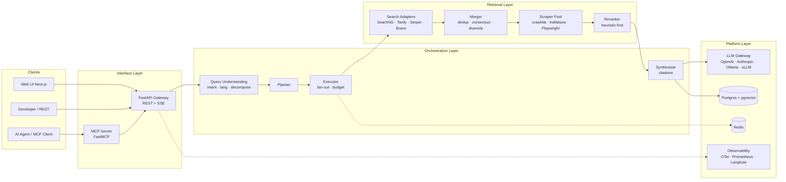

# MetaSearch — AI Meta-Search & Deep Research Engine

> Hệ thống tìm kiếm đa nguồn phục vụ AI: **Meta-Search (SearXNG) → Crawl & Extract → Dedup & Rerank → Synthesize có trích dẫn**, đóng gói thành REST API + SSE Streaming + MCP Server + Web UI.

Trạng thái: **Phase 0 — Scaffold hoàn tất** (monorepo `api/` + `frontend/` + `deploy/` + CI xanh: 23 test PASS, ruff/bandit sạch, Next.js build OK). Thiết kế đầy đủ nằm trong [docs/](docs/), plan chi tiết ở [docs/12-roadmap-plan.md](docs/12-roadmap-plan.md).

---

## 1. MetaSearch giải quyết vấn đề gì?

| Vấn đề thực tế | Cách MetaSearch xử lý |
|---|---|
| LLM bị "ảo giác", kiến thức cũ | Mọi câu trả lời được tổng hợp từ trang web thật, **bắt buộc có trích dẫn `[n]`** map ngược về nguồn; citation được validate sau khi sinh |
| Một search engine = một góc nhìn | Fan-out đồng thời **70+ engines** qua SearXNG (Google, Bing, DuckDuckGo, Brave, Wikipedia, Google News/Scholar…) + adapter riêng cho Tavily / Serper / Brave API |
| Nội dung web đầy rác HTML/JS/ads | Extraction pipeline (crawl4ai + trafilatura + Playwright fallback) biến URL → **Markdown sạch tối ưu cho context LLM** |
| Kết quả trùng lặp, kém liên quan | Canonical URL + SimHash dedup → consensus scoring (nhiều engine cùng trả về → boost) → **rerank heuristic-first (0ms)**, tuỳ chọn int8 ONNX multilingual ~300MB hoặc API rerank |
| AI Agent cần công cụ tìm kiếm | **MCP Server** với 4 tool: `web_search`, `web_scrape`, `web_search_and_scrape`, `deep_research` |
| Chi phí API search hàng tháng | Self-host SearXNG = **$0 cho phần search**; chỉ trả tiền LLM (có thể dùng Ollama/vLLM local để về 0) |

## 2. Kiến trúc một trang



Chi tiết đầy đủ: [docs/02-system-architecture.md](docs/02-system-architecture.md) · Pipeline từng stage: [docs/03-search-pipeline.md](docs/03-search-pipeline.md)

## 3. Quick Start (mục tiêu sau Phase 1)

```bash
git clone https://github.com/hunglinhpt/MetaSearch.git
cd MetaSearch
cp deploy/.env.example .env          # điền LLM_API_KEY
docker compose -f deploy/docker-compose.yml up -d
# SearXNG   : http://localhost:8080
# API       : http://localhost:8000/docs
# Web UI    : http://localhost:3000

curl -X POST http://localhost:8000/v1/search \
  -H "Content-Type: application/json" \
  -d '{"query": "So sánh PostgreSQL và MySQL 2025", "language": "vi"}'
```

## 4. Cấu trúc repo

```
MetaSearch/
├── README.md                  ← bạn đang ở đây
├── docs/                      ← thiết kế chi tiết (12 tài liệu + 8 ADR)
│   ├── 01-product-requirements.md
│   ├── 02-system-architecture.md
│   ├── 03-search-pipeline.md
│   ├── 04-agents-orchestration.md
│   ├── 05-data-model.md
│   ├── 06-api-spec.md
│   ├── 07-mcp-integration.md
│   ├── 08-deployment.md
│   ├── 09-observability-eval.md
│   ├── 10-security-compliance.md
│   ├── 11-testing-strategy.md
│   ├── 12-roadmap-plan.md     ← plan chi tiết 8 tuần (gồm KPI + rủi ro)
│   └── adr/                   ← 8 Architecture Decision Records
├── api/                       ← FastAPI orchestration (lớp mỏng ~2–3k LOC)
│   ├── app/
│   │   ├── core/              ← config, logging, errors, middleware, metrics
│   │   ├── db/                ← SQLAlchemy models + async session
│   │   ├── api/               ← ops (/healthz, /readyz, /metrics) + v1 routers
│   │   ├── retrieval/         ← SearXNG adapter, engine registry, merger (Phase 1)
│   │   ├── extraction/        ← trafilatura + crawl4ai client + SSRF guard (Phase 1)
│   │   ├── orchestration/     ← query understanding, planner, executor (Phase 1+)
│   │   └── llm/               ← LLM gateway (Phase 1)
│   ├── alembic/versions/      ← migration schema v1 (12 bảng + pgvector)
│   ├── tests/                 ← pytest suite
│   └── pyproject.toml         ← deps + ruff/pytest/bandit config
├── frontend/                  ← Next.js 15 + React 19 (Web UI)
│   ├── app/                   ← App Router (layout, page, globals.css)
│   └── package.json
├── deploy/
│   ├── docker-compose.yml     ← reference stack đầy đủ
│   ├── searxng/settings.yml   ← cấu hình SearXNG (bật JSON API)
│   └── .env.example
└── .github/workflows/ci.yml   ← CI: lint + unit test + security scan + build
```

## 5. Bản đồ tài liệu

| Tài liệu | Trả lời câu hỏi |
|---|---|
| [01 Product Requirements](docs/01-product-requirements.md) | Ai dùng, dùng để làm gì, tiêu chí chấp nhận? |
| [02 System Architecture](docs/02-system-architecture.md) | Các tầng, component, luồng dữ liệu, công nghệ, hardware profile 16GB? |
| [03 Search Pipeline](docs/03-search-pipeline.md) | 1 câu hỏi đi qua 11 stage như thế nào, latency budget? |
| [04 Agents Orchestration](docs/04-agents-orchestration.md) | Planner/Executor, Deep Research loop, budget control? |
| [05 Data Model](docs/05-data-model.md) | Schema Postgres, cache Redis, vector, retention? |
| [06 API Spec](docs/06-api-spec.md) | Endpoint REST/SSE, request/response, error model? |
| [07 MCP Integration](docs/07-mcp-integration.md) | Tool cho AI Agent, contract, ví dụ gọi? |
| [08 Deployment](docs/08-deployment.md) | Docker Compose, profile dev 16GB / prod VPS, scaling? |
| [09 Observability & Eval](docs/09-observability-eval.md) | Trace/metrics/log, eval chất lượng tìm kiếm? |
| [10 Security & Compliance](docs/10-security-compliance.md) | SSRF, robots.txt, rate limit, secrets? |
| [11 Testing Strategy](docs/11-testing-strategy.md) | Test strategy, golden set, đo citation accuracy? |
| [12 Roadmap & Plan](docs/12-roadmap-plan.md) | **Plan chi tiết 5 phase / 8 tuần, KPI, rủi ro & mitigation** |

> Chi phí (cost model) và rủi ro (risks) được gộp vào [docs/12-roadmap-plan.md](docs/12-roadmap-plan.md) để giữ bộ tài liệu gọn.

## 6. Đứng trên vai người khổng lồ

MetaSearch không phát minh lại bánh xe — thiết kế này tổng hợp tinh hoa từ các hệ thống mã nguồn mở tiêu biểu:

| Nguồn tham khảo | Điều mượn vào MetaSearch |
|---|---|
| [assafelovic/gpt-researcher](https://github.com/assafelovic/gpt-researcher) | Mẫu **Planner & Executor**: tách câu hỏi lớn → sub-queries, gọi song song, tổng hợp có dẫn nguồn; abstraction `retrievers/` + `scraper/` |
| [ItzCrazyKns/Perplexica (Vane)](https://github.com/ItzCrazyKns/Perplexica) | Tích hợp **SearXNG** làm unified search API; lọc đoạn văn bằng cosine similarity trước khi đưa vào LLM; streaming answer |
| [rashadphz/farfalle](https://github.com/rashadphz/farfalle) | Tách lớp sạch (search/scraper/LLM provider), hoán đổi linh hoạt cloud ↔ local LLM |
| [miurla/morphic](https://github.com/miurla/morphic) · [scira-ai/scira](https://github.com/scira-ai/scira) | **Generative UI**: hiển thị kết quả dạng thẻ/bảng, multi-tool calling |
| [searxng/searxng](https://github.com/searxng/searxng) | **Trái tim meta-search**: 70+ engines, khử trùng lặp, consensus ranking, xuất JSON |
| [unclecode/crawl4ai](https://github.com/unclecode/crawl4ai) | Extraction dành riêng cho LLM: loại ads/menu, xuất Markdown, JS rendering |
| [jina-ai/reader](https://github.com/jina-ai/reader) | Fallback extractor cho trang khó (dùng `r.jina.ai` khi self-extract thất bại) |
| [siosig/searxng-crawl4ai-mcp](https://github.com/siosig/searxng-crawl4ai-mcp) | Mẫu ghép SearXNG + Crawl4AI thành **MCP tool duy nhất** `web_search_and_scrape` |
| [chen150450/multi-search-aggregator](https://github.com/chen150450/multi-search-aggregator) | **Engine registry pluggable + hot config** (bật/tắt engine, chỉnh weight không cần restart); **multi-signal scoring** (keyword match + engine authority + freshness + vector similarity); SSE per-engine progress (`engine_done`); graceful degradation (timeout → trả kết quả một phần) |

Điểm **khác biệt** của MetaSearch: orchestration mỏng (~2–3k LOC) đứng trên 4 "gã khổng lồ" — **SearXNG** (meta-search), **crawl4ai** (JS extraction), **trafilatura** (static extraction), **FastMCP** (agent interface). Engine đổi cấu trúc → chỉ nâng image giant, orchestration không đổi; chi phí tầng search = $0. Chiến lược chi tiết: [ADR-007](docs/adr/ADR-007-giants-first.md).

## 7. License & phạm vi

Repo private — dùng nội bộ. Tuân thủ robots.txt và điều khoản các engine (xem [docs/10-security-compliance.md](docs/10-security-compliance.md)).
