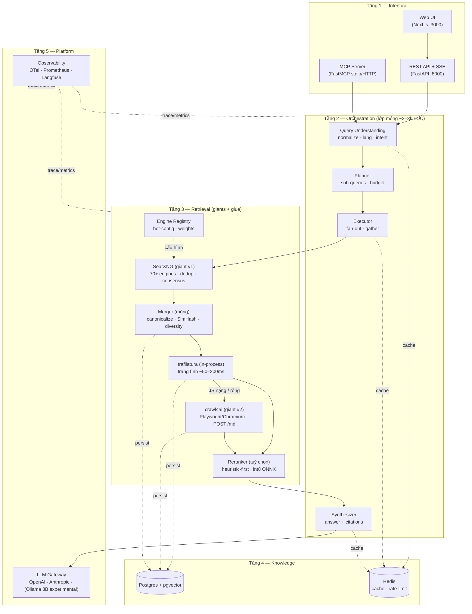

# 02 — System Architecture

## 0. Nguyên tắc: Đứng trên vai người khổng lồ

Hệ thống KHÔNG tự viết tầng meta-search hay web extraction. Ta lắp ghép các "giant" mã nguồn mở đã được cộng đồng bảo trì liên tục, và chỉ viết **lớp orchestration mỏng (~2–3k LOC)** ở giữa:

| Giant | Vai trò | Ta được gì miễn phí | Khi engine đổi cấu trúc |
|---|---|---|---|
| **SearXNG** | Meta-search core | Fan-out 70+ engines (Google/Bing/DDG/Brave…), khử trùng lặp, consensus ranking, Unified JSON API (`formats: [html, json]`) | Chỉ nâng image SearXNG — orchestration không đổi |
| **crawl4ai** | Web extraction cho LLM | Playwright/Chromium đóng gói sẵn, làm sạch HTML → Markdown, API `POST /md` | Chỉ nâng image crawl4ai |
| **trafilatura** (in-process) | Extraction nhanh | ~50–200ms/trang tĩnh, độ chính xác cao | `pip install -U trafilatura` |
| **FastMCP** | Interface cho AI Agent | Chuẩn MCP, 4 tools `web_search`/`web_scrape`/`web_search_and_scrape`/`deep_research` | Thư viện pip |

Lớp mỏng ta tự viết: query understanding, planner/executor, SSRF guard, citation validation, SSE, cache, LLM Gateway. Tách biệt hoàn toàn "đi tìm kiếm trên mạng" (giants) khỏi "suy luận của AI" (orchestration) — hệ thống ổn định ngay cả khi một công cụ tìm kiếm thay đổi cấu trúc.

## 1. Tổng quan 5 tầng



## 2. Trách nhiệm từng tầng

### Tầng 1 — Interface
- **REST API** (`/v1/search`, `/v1/answer`, `/v1/scrape`, `/v1/research`, `/v1/engines`): stateless, auth bằng API key, trả JSON; SSE cho streaming.
- **MCP Server**: bọc cùng orchestration layer thành 4 tools cho AI Agent (stdio cho local, streamable HTTP cho remote).
- **Web UI**: Next.js client thuần của REST/SSE — không có logic nghiệp vụ riêng.

### Tầng 2 — Orchestration
- **Query Understanding**: normalize (unicode NFC, lowercase tùy engine), detect ngôn ngữ (fastText/heuristic), classify intent (`factual` / `exploratory` / `navigational` / `code` / `news`), quyết định route (engine set, K, depth).
- **Planner**: với quick answer chỉ chọn engine set + K; với deep research tách sub-queries (breadth 3–5, depth 1–2) và đặt budget (max_iterations, max_tokens, max_time).
- **Executor**: fan-out song song có timeout per engine, gather với partial results (graceful degradation).
- **Synthesizer**: build context từ chunks đã rerank, gọi LLM streaming, post-validate citations.

### Tầng 3 — Retrieval (giants + glue)
- **SearXNG (giant #1)**: toàn bộ tầng meta-search — fan-out 70+ engines, khử trùng lặp, consensus ranking, Unified JSON API. Ta KHÔNG viết code gọi Google/Bing/DDG; chỉ 1 call `GET /search?format=json`.
- **Engine Registry** (mỏng, mượn từ multi-search-aggregator): mỗi engine = 1 entry `{id, name, type, adapter, weight, enabled, timeout_ms, category}`; hot-config qua API/DB, không restart. SearXNG là primary; adapter riêng cho Tavily/Serper/Brave và vertical (arXiv, SO, Reddit, Wikipedia) chỉ bật khi có key/intent.
- **Merger** (mỏng): canonicalize URL → exact dedup → SimHash near-dup → chuẩn hoá consensus (SearXNG đã tính sẵn score) → engine weight → freshness → diversity cap.
- **Extraction (giant #2)**: trafilatura in-process (~50–200ms trang tĩnh) → crawl4ai service (Playwright/Chromium, `POST /md`) cho trang JS nặng → jina reader fallback cuối. Semaphore 4–6, timeout 8s, max 2 URL/domain, SSRF guard, robots.txt.
- **Reranker (tuỳ chọn)**: heuristic-first (consensus + keyword + freshness — 0ms); nếu cần thêm độ chính xác: jina-reranker-v2-base-multilingual int8 ONNX (~300MB) hoặc API rerank (Jina/Cohere). KHÔNG chạy bge-reranker-v2-m3 local trên máy 16GB (~2.3GB fp32, CPU 2–3s).

### Tầng 4 — Knowledge
- **Postgres + pgvector**: nguồn sự thật (queries, results, documents, chunks, answers, engine_health, api_keys) + semantic cache + embedding của chunks.
- **Redis**: L1 cache (search TTL 15–60m, pages TTL 6–24h, answers TTL 1–6h), rate limiter, distributed lock, SSE pub/sub nếu scale nhiều instance.

### Tầng 5 — Platform
- **LLM Gateway**: interface thống nhất, model routing theo task (quick → model nhỏ; deep research → model lớn), retry + fallback provider, token metering.
- **Observability**: OTel span per pipeline stage, Prometheus metrics, Langfuse trace LLM (prompt, tokens, cost).

## 3. Luồng dữ liệu (quick answer)

```
Request → auth/rate-limit (5ms)
        → normalize + lang detect (10ms)
        → cache check L1 Redis (2ms) [hit → trả ngay]
        → intent classify (150–300ms, có cache)
        → fan-out engines (800–2000ms) ── timeout per engine, partial OK
        → merge/dedup/score (50ms)
        → chọn top-K=10 URL
        → scrape song song (1–4s, semaphore 4–6, timeout 8s)
        → extract → markdown → chunk 512 tok / overlap 64 (100ms)
        → rerank heuristic-first (0ms; tuỳ chọn int8 ~300MB nếu bật)
        → LLM synthesize streaming (TTFT ~1s)
        → persist + cache write (async, không chặn response)
```

## 4. Quyết định kiến trúc then chốt

| Quyết định | Lý do | ADR |
|---|---|---|
| SearXNG làm meta-search core | 70+ engines, self-host $0, cộng đồng cập nhật liên tục | [ADR-001](adr/ADR-001-searxng-core.md) |
| Python + FastAPI + asyncio | Hệ sinh thái crawl/LLM/NLP mạnh nhất, async I/O phù hợp fan-out | [ADR-002](adr/ADR-002-python-fastapi.md) |
| Extraction hybrid 4 tầng | Tốc độ (trafilatura) vs độ phủ (Playwright) vs chi phí (jina) | [ADR-003](adr/ADR-003-hybrid-extraction.md) |
| Postgres + pgvector thay Qdrant | 1 DB ít vận hành, đủ cho <10M vectors | [ADR-004](adr/ADR-004-postgres-pgvector.md) |
| SSE cho streaming | Đơn giản, HTTP thuần, đi qua proxy chuẩn | [ADR-005](adr/ADR-005-sse-streaming.md) |
| MCP FastMCP | Chuẩn mở cho AI Agent, Python-native | [ADR-006](adr/ADR-006-mcp-fastmcp.md) |
| Giants-first composition | SearXNG + crawl4ai + trafilatura + FastMCP; chỉ viết lớp mỏng | [ADR-007](adr/ADR-007-giants-first.md) |
| Hardware-constrained inference | 16GB RAM / Iris Xe: cloud LLM mặc định, rerank heuristic-first | [ADR-008](adr/ADR-008-hardware-inference.md) |

## 5. Mở rộng

- **Thêm engine mới**: viết adapter (1 file) + đăng ký vào registry (1 dòng) — không sửa orchestration.
- **Thêm LLM provider**: thêm 1 entry vào gateway config.
- **Scale ngang**: API stateless → chạy nhiều instance sau LB; Redis pub/sub cho SSE; Postgres read replica.
- **Swap SearXNG**: chỉ thay adapter primary — orchestration không đổi.

## 6. Hardware profile — laptop 16GB (dev) vs VPS (prod)

Máy dev: 16GB RAM (15.7 usable), Windows 11 + browser + IDE đã chiếm 6–8GB, Intel Iris Xe (không VRAM rời). WSL2 mặc định chiếm 50% RAM → cap 6GB qua `%UserProfile%\.wslconfig`:

```ini
[wsl2]
memory=6GB
processors=4
swap=2GB
```

### Ngân sách RAM (profile dev-laptop)

| Service | mem_limit | Ghi chú |
|---|---|---|
| searxng | 512MB | uwsgi 1 worker |
| redis | 256MB | `--maxmemory 256mb allkeys-lru` |
| postgres | 768MB | `shared_buffers=256MB` |
| api | 512MB | uvicorn 1–2 workers |
| crawl4ai (+Chromium) | 1–1.5GB | concurrency 2, 1 browser instance |
| frontend | 256MB | Next.js standalone |
| **Tổng stack** | **~4GB** | headroom ~2GB trong WSL2 6GB |

### Quyết định inference theo ràng buộc (chi tiết [ADR-008](adr/ADR-008-hardware-inference.md))

| Thành phần | Quyết định | Lý do |
|---|---|---|
| LLM | Cloud API (OpenAI/Anthropic) mặc định; Ollama 3B q4 chỉ experimental offline | 7B–8B local cần 4–8GB → đè stack |
| Reranker | Heuristic-first; tuỳ chọn int8 ONNX ~300MB hoặc API rerank | bge-reranker-v2-m3 local ~2.3GB, CPU 2–3s |
| Embedding | Bỏ semantic cache v1; nếu cần: e5-small int8 384 dims (~150MB) | bge-m3 local ~2.2GB |
| Playwright | Chỉ qua crawl4ai service, 1 browser, concurrency 2 | Chromium ~500MB–1GB |
| Iris Xe | Không dùng inference (không CUDA); OpenVINO EP tuỳ chọn sau | |
