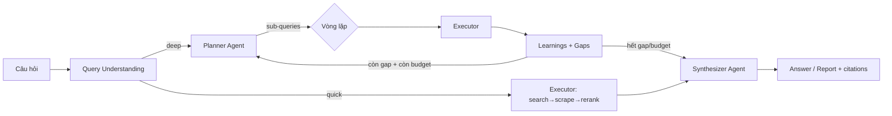

# 04 — Agents & Orchestration

## 1. Mô hình agent

MetaSearch dùng **2 agent chính + 1 vòng lặp**, lấy tinh thần Planner/Executor của gpt-researcher nhưng gọn hơn:



### Planner Agent
- Input: câu hỏi gốc + ngôn ngữ + budget.
- Output (JSON): `sub_queries[]` (3–5, mỗi cái có `purpose`), `search_strategy` (engine set, categories), `budget {max_iterations, max_tokens, max_time_s}`.
- Prompt yêu cầu: sub-queries phủ các khía cạnh khác nhau (định nghĩa, dữ liệu số, quan điểm trái chiều, case thực tế); không trùng lặp.
- Model: LLM nhỏ (gpt-4o-mini / claude-haiku) — chỉ cần reasoning nhẹ.

### Executor (không phải LLM agent)
- Hàm thuần async: nhận list queries → fan-out → merge → scrape → rerank → trả `ContextPack`.
- Không dùng LLM ở đây (tiết kiệm, deterministic, dễ test).

### Synthesizer Agent
- Quick answer: 1 lần gọi LLM streaming với ContextPack.
- Deep research: nhận `learnings[]` + `gaps[]` từ các vòng, viết report có cấu trúc (Executive summary → Phân tích từng khía cạnh → So sánh → Kết luận → Tài liệu tham khảo).

## 2. Deep Research loop

```
iteration = 0
context = ContextPack()
while iteration < budget.max_iterations:
    if iteration == 0: queries = planner.initial_subqueries
    else:              queries = planner.next_queries(gaps, learnings)
    if not queries: break
    pack = executor.run(queries)          # search + scrape + rerank
    context.merge(pack)
    learnings, gaps = extractor.extract(pack, question)   # LLM nhỏ
    if not gaps: break
    iteration += 1
report = synthesizer.write_report(context, question, learnings)
```

- **Budget mặc định**: `max_iterations=3`, `max_tokens=150k`, `max_time_s=180`.
- **Extractor** (LLM nhỏ): từ mỗi ContextPack rút `learnings` (fact + citation) và `gaps` (câu hỏi chưa trả lời được).
- Mỗi vòng ghi trace riêng (Langfuse) để debug và tính cost.

## 3. ContextPack

```python
@dataclass
class ContextPack:
    chunks: list[Chunk]        # đã rerank, có citation_id
    sources: list[Source]      # url, title, domain, found_by, published_at
    learnings: list[Learning]  # fact + citation_id (deep research)
    gaps: list[str]            # câu hỏi chưa trả lời
    stats: dict                # tokens, cost, latency per stage
```

- `merge()`: dedup theo canonical URL + SimHash, giữ chunk score cao nhất.
- Serialize vào prompt: mỗi chunk 1 block `[n] (domain, date)\n<markdown>`.

## 4. LLM Gateway

```python
class LLMGateway:
    async def complete(self, task: str, messages, *, stream=False, **kw) -> ...
    # task → model routing: "intent" → nhỏ; "synthesize" → vừa; "report" → lớn
```

| Task | Model mặc định | Fallback |
|---|---|---|
| intent / planner / extractor | gpt-4o-mini | claude-haiku |
| synthesize (quick) | gpt-4o-mini | claude-haiku |
| report (deep) | gpt-4o / claude-sonnet | — (cloud-to-cloud) |

> **Máy 16GB**: KHÔNG fallback sang Ollama 7B–8B (4–8GB RAM sẽ đè stack — xem [ADR-008](adr/ADR-008-hardware-inference.md)). Ollama chỉ chạy 3B q4 ở chế độ experimental offline, tắt theo mặc định.

- Retry 2 lần với exponential backoff; fallback provider khi 429/5xx.
- Metering: log input/output tokens + cost per call (Langfuse).
- Hỗ trợ OpenAI-compatible endpoint (vLLM/Ollama) → tự host được trên prod VPS; trên máy dev 16GB chỉ dùng Ollama 3B experimental.

## 5. Prompt templates (tóm tắt)

- **System synthesize**: "Bạn là trợ lý nghiên cứu. Trả lời CHỈ dựa trên ngữ cảnh. Mọi khẳng định phải kèm [n] tương ứng nguồn. Nếu ngữ cảnh không đủ, nói rõ. Trả lời bằng ngôn ngữ của câu hỏi."
- **Planner**: trả JSON schema chặt (dùng `response_format=json_schema` khi provider hỗ trợ).
- **Extractor**: output JSON `{learnings: [{fact, citation_id}], gaps: [str]}`.

## 6. Xử lý lỗi orchestration

| Tình huống | Hành vi |
|---|---|
| Tất cả engine fail | Trả 503 + `Retry-After`, kèm `engines_status` |
| Scrape 0/10 URL thành công | Synthesize từ snippets (đánh dấu `low_confidence: true`) |
| LLM fail sau retry | Trả kết quả raw search + chunks (không answer), status `partial` |
| Budget vượt (deep research) | Dừng loop, viết report từ những gì có, đánh dấu `truncated: true` |
