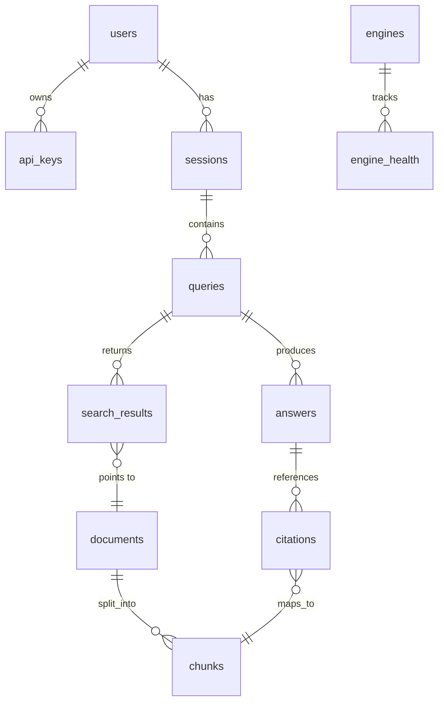

# 05 — Data Model

## 1. ERD tổng quan



## 2. Bảng Postgres

### users, api_keys, sessions
```sql
CREATE TABLE users (
  id UUID PRIMARY KEY DEFAULT gen_random_uuid(),
  email TEXT UNIQUE,
  role TEXT NOT NULL DEFAULT 'user',        -- user | admin
  created_at TIMESTAMPTZ DEFAULT now()
);
CREATE TABLE api_keys (
  id UUID PRIMARY KEY DEFAULT gen_random_uuid(),
  user_id UUID REFERENCES users(id),
  key_hash TEXT NOT NULL,                    -- sha256, không lưu plaintext
  name TEXT,
  rate_limit_rpm INT DEFAULT 60,
  enabled BOOLEAN DEFAULT true,
  created_at TIMESTAMPTZ DEFAULT now()
);
CREATE TABLE sessions (
  id UUID PRIMARY KEY DEFAULT gen_random_uuid(),
  user_id UUID REFERENCES users(id),
  title TEXT,
  created_at TIMESTAMPTZ DEFAULT now()
);
```

### queries, search_results, documents, chunks
```sql
CREATE TABLE queries (
  id UUID PRIMARY KEY DEFAULT gen_random_uuid(),
  session_id UUID REFERENCES sessions(id),
  raw_text TEXT NOT NULL,
  normalized_text TEXT,
  lang TEXT,                                 -- 'vi', 'en'
  intent TEXT,                               -- factual|exploratory|navigational|code|news
  params JSONB,                              -- engines, k, depth, categories
  created_at TIMESTAMPTZ DEFAULT now()
);
CREATE INDEX idx_queries_normalized ON queries(normalized_text);

CREATE TABLE documents (
  id UUID PRIMARY KEY DEFAULT gen_random_uuid(),
  canonical_url TEXT UNIQUE NOT NULL,
  url_hash TEXT NOT NULL,                    -- sha256(canonical_url), lookup nhanh
  title TEXT,
  domain TEXT,
  published_at TIMESTAMPTZ,
  content_md TEXT,                           -- markdown đã extract
  content_hash TEXT,                         -- simhash để near-dup
  fetched_at TIMESTAMPTZ,
  fetch_status TEXT,                         -- ok | partial | failed
  extractor_used TEXT                        -- trafilatura|crawl4ai|playwright|jina
);
CREATE INDEX idx_documents_domain ON documents(domain);

CREATE TABLE chunks (
  id UUID PRIMARY KEY DEFAULT gen_random_uuid(),
  document_id UUID REFERENCES documents(id) ON DELETE CASCADE,
  position INT NOT NULL,
  heading_path TEXT,                         -- "H1 > H2 > H3"
  content TEXT NOT NULL,
  token_count INT,
  embedding vector(1024),                    -- bge-m3 (prod); dev 16GB: e5-small int8 384 dims nếu bật L2
  created_at TIMESTAMPTZ DEFAULT now()
);
CREATE INDEX idx_chunks_embedding ON chunks
  USING hnsw (embedding vector_cosine_ops) WITH (m=16, ef_construction=64);
CREATE INDEX idx_chunks_document ON chunks(document_id, position);
```

### search_results, answers, citations
```sql
CREATE TABLE search_results (
  id UUID PRIMARY KEY DEFAULT gen_random_uuid(),
  query_id UUID REFERENCES queries(id),
  document_id UUID REFERENCES documents(id),
  rank INT,
  score REAL,
  consensus INT,                             -- số engine cùng trả
  found_by TEXT[],                           -- ['searxng','tavily']
  raw_snippet TEXT,
  created_at TIMESTAMPTZ DEFAULT now()
);

CREATE TABLE answers (
  id UUID PRIMARY KEY DEFAULT gen_random_uuid(),
  query_id UUID REFERENCES queries(id),
  kind TEXT NOT NULL,                        -- quick | deep
  content_md TEXT,
  model TEXT,
  input_tokens INT, output_tokens INT, cost_usd REAL,
  latency_ms INT,
  status TEXT,                               -- complete | partial | failed
  created_at TIMESTAMPTZ DEFAULT now()
);

CREATE TABLE citations (
  id UUID PRIMARY KEY DEFAULT gen_random_uuid(),
  answer_id UUID REFERENCES answers(id) ON DELETE CASCADE,
  n INT NOT NULL,                            -- số [n] trong text
  chunk_id UUID REFERENCES chunks(id),
  url TEXT,
  valid BOOLEAN DEFAULT true                 -- sau post-validate
);
```

### engines, engine_health (mượn từ multi-search-aggregator)
```sql
CREATE TABLE engines (
  id TEXT PRIMARY KEY,                       -- 'searxng', 'tavily', 'arxiv'
  name TEXT NOT NULL,
  category TEXT NOT NULL,                    -- general|academic|developer|social|news
  adapter TEXT NOT NULL,
  weight REAL DEFAULT 1.0,
  enabled BOOLEAN DEFAULT true,
  timeout_ms INT DEFAULT 3000,
  max_results INT DEFAULT 15,
  requires_key BOOLEAN DEFAULT false,
  config JSONB DEFAULT '{}'                  -- engine_overrides
);

CREATE TABLE engine_health (
  engine_id TEXT REFERENCES engines(id),
  window_start TIMESTAMPTZ NOT NULL,
  calls INT, successes INT, failures INT,
  p50_ms INT, p95_ms INT,
  consecutive_failures INT DEFAULT 0,
  disabled_reason TEXT,
  PRIMARY KEY (engine_id, window_start)
);
```

### semantic_cache (L2)
```sql
CREATE TABLE semantic_cache (
  id UUID PRIMARY KEY DEFAULT gen_random_uuid(),
  query_text TEXT NOT NULL,
  query_embedding vector(1024),              -- prod: bge-m3; dev 16GB: 384 dims (e5-small) hoặc tắt L2
  answer_id UUID REFERENCES answers(id),
  model TEXT,
  hit_count INT DEFAULT 0,
  created_at TIMESTAMPTZ DEFAULT now(),
  expires_at TIMESTAMPTZ
);
CREATE INDEX idx_semcache_emb ON semantic_cache
  USING hnsw (query_embedding vector_cosine_ops);
```

## 3. Redis keys

| Pattern | Nội dung | TTL |
|---|---|---|
| `sr:{sha1}` | Kết quả search đã merge (JSON) | 15–60m |
| `pg:{sha1(url)}` | Markdown của 1 trang | 6–24h |
| `an:{sha1}` | Answer hoàn chỉnh | 1–6h |
| `neg:{sha1(url)}` | Negative cache URL lỗi | 1h |
| `rl:{api_key}:{minute}` | Rate limit counter | 60s |
| `eng:cfg` | Snapshot engine config (hot) | — (invalidate khi PATCH) |
| `lock:scrape:{url_hash}` | Distributed lock chống scrape trùng | 30s |

## 4. Quy ước

- Mọi bảng có `created_at TIMESTAMPTZ DEFAULT now()`.
- UUID v4 cho id; `url_hash`/`content_hash` dùng sha256 hex.
- JSONB cho params/config linh hoạt; tránh thêm cột khi chưa chắc.
- Migration: Alembic; mỗi thay đổi schema 1 file migration.
- Retention: `search_results`/`answers` giữ 90 ngày (job dọn nightly); `documents`/`chunks` giữ theo LRU dung lượng.
- Embedding dims theo profile: prod = bge-m3 1024; dev laptop 16GB = e5-small int8 384 (hoặc tắt semantic cache L2 — xem [ADR-008](adr/ADR-008-hardware-inference.md)).
