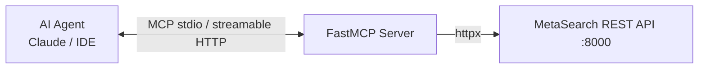

# 07 — MCP Server Integration

## 1. Mục tiêu

Cho phép AI Agent (Claude Desktop, IDE, agent framework) dùng MetaSearch như **một bộ tool duy nhất** thay vì tự ghép search + scraper. Lấy mô hình `web_search_and_scrape` từ searxng-crawl4ai-mcp, mở rộng thành 4 tools.

## 2. Tools

### `web_search`
```json
// input
{"query": "…", "lang": "vi", "k": 10, "engines": ["searxng"], "freshness_days": 90}
// output (markdown cho LLM đọc)
"1. [Title](url) — snippet… (score 0.87, 3 engines)\n2. …"
```

### `web_scrape`
```json
// input
{"urls": ["https://…"], "max_chars": 8000}
// output
"# Title\n\nmarkdown sạch (đã cắt theo max_chars)…"
```

### `web_search_and_scrape` (tool chủ lực)
```json
// input
{"query": "…", "lang": "vi", "k": 5, "scrape_top": 3, "max_chars_per_page": 4000}
// output
"## Kết quả tìm kiếm\n1. [Title](url) — snippet\n\n## Nội dung trang\n### [1] Title (url)\nmarkdown…"
```
- 1 call thay 2: search → chọn top `scrape_top` → scrape song song → trả context gọn cho LLM.

### `deep_research` (async)
```json
// input
{"query": "…", "breadth": 4, "depth": 2, "max_time_s": 180}
// output
{"research_id": "…", "status": "queued", "poll_hint": "GET /v1/research/{id}"}
```
- MCP trả ngay job id; agent poll hoặc dùng resource `metasearch://research/{id}`.

## 3. Kiến trúc



- **FastMCP** (Python) — cùng codebase với API, chạy 2 chế độ:
  - `stdio`: cho Claude Desktop / local agent (subprocess).
  - `streamable HTTP`: cho agent remote (`/mcp` trên cùng FastAPI app).
- MCP layer **mỏng**: chỉ map tool input → REST call → format output markdown. Không có logic nghiệp vụ riêng → 1 nguồn sự thật.

## 4. Cấu hình Claude Desktop (ví dụ)

```json
{
  "mcpServers": {
    "metasearch": {
      "command": "python",
      "args": ["-m", "metasearch.mcp"],
      "env": {"METASEARCH_API_URL": "http://localhost:8000", "METASEARCH_API_KEY": "<key>"}
    }
  }
}
```

## 5. Nguyên tắc thiết kế tool

- Output **markdown thuần** (LLM đọc tốt hơn JSON thô); giữ `[n]` citation để agent trích nguồn.
- Mọi tool có timeout + error message thân thiện ("engine searxng timeout, thử lại hoặc giảm k").
- `web_search_and_scrape` tự giới hạn tổng chars (~12k) để không phình context agent.
- Tool descriptions viết rõ "when to use" để model chọn đúng tool.
