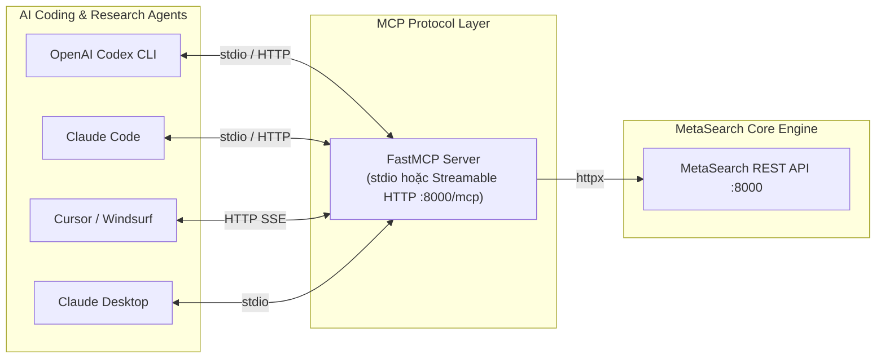

# 07 — MCP Server Integration & Agent Ecosystem

## 1. Mục tiêu

Cho phép AI Agent (OpenAI Codex CLI, Claude Code, Cursor, Windsurf, Claude Desktop, Antigravity) dùng MetaSearch như **một bộ tool duy nhất** thay vì tự ghép search + scraper. Lấy mô hình `web_search_and_scrape` từ searxng-crawl4ai-mcp, mở rộng thành 4 tools chất lượng cao.

## 2. Tools

### `web_search`
```json
// input
{"query": "…", "lang": "vi", "k": 10, "engines": ["searxng"], "freshness_days": 90}
// output (markdown cho LLM đọc)
"1. [Title](url) — snippet… (score 0.87, 3 engines)\n2. …"
```

### `web_scrape`
```json
// input
{"urls": ["https://…"], "max_chars": 8000}
// output
"# Title\n\nmarkdown sạch (đã cắt theo max_chars)…"
```

### `web_search_and_scrape` (tool chủ lực cho Coding & Research Agents)
```json
// input
{"query": "…", "lang": "vi", "k": 5, "scrape_top": 3, "max_chars_per_page": 4000}
// output
"## Kết quả tìm kiếm\n1. [Title](url) — snippet\n\n## Nội dung trang\n### [1] Title (url)\nmarkdown…"
```
- 1 call thay 2: search → chọn top `scrape_top` → scrape song song → trả context gọn cho LLM. Tối ưu đặc biệt cho các agent lập trình tra cứu thư viện, sửa lỗi runtime và đọc docs.

### `deep_research` (async)
```json
// input
{"query": "…", "breadth": 4, "depth": 2, "max_time_s": 180, "profile": "developer"}
// output
{"research_id": "…", "status": "queued", "poll_hint": "GET /v1/research/{id}"}
```
- MCP trả ngay job id; agent poll hoặc lắng nghe SSE `/v1/research/{id}/events`. Hỗ trợ các profile domain (`developer`, `academic`, `comparative`, `general`).

## 3. Kiến trúc



- **FastMCP** (Python) — cùng codebase với API, chạy 2 chế độ:
  - `stdio`: cho Claude Desktop / Codex CLI / local agent (subprocess).
  - `streamable HTTP`: cho agent remote (`/mcp` trên cùng FastAPI app).
- MCP layer **mỏng**: chỉ map tool input → REST call → format output markdown. Không có logic nghiệp vụ riêng → 1 nguồn sự thật.

## 4. Hướng dẫn cấu hình Agent Ecosystem

### A. OpenAI Codex CLI / Agent
Trong file cấu hình MCP của OpenAI Codex CLI (hoặc `codex.config.json`):
```json
{
  "mcpServers": {
    "metasearch": {
      "command": "python",
      "args": ["-m", "app.mcp"],
      "cwd": "/path/to/MetaSearch/api",
      "env": {
        "METASEARCH_API_URL": "http://localhost:8000",
        "METASEARCH_API_KEY": "msk_..."
      }
    }
  }
}
```

### B. Claude Code (`claude-code`)
Thêm tool server trực tiếp qua lệnh CLI:
```bash
claude mcp add metasearch python -m app.mcp --cwd /path/to/MetaSearch/api
```
Hoặc kết nối qua HTTP endpoint khi API đang chạy:
```bash
claude mcp add metasearch http://localhost:8000/mcp
```

### C. Cursor & Windsurf IDE
Trong `Cursor Settings > Features > MCP`:
- Type: `command`
- Command: `python -m app.mcp`
- Directory: `/path/to/MetaSearch/api`
- Environment Variables: `METASEARCH_API_URL=http://localhost:8000`

### D. Claude Desktop
Trong `claude_desktop_config.json`:
```json
{
  "mcpServers": {
    "metasearch": {
      "command": "python",
      "args": ["-m", "app.mcp"],
      "cwd": "/path/to/MetaSearch/api",
      "env": {
        "METASEARCH_API_URL": "http://localhost:8000"
      }
    }
  }
}
```

## 5. Nguyên tắc thiết kế tool cho Agent

- Output **markdown thuần** (LLM đọc tốt hơn JSON thô); giữ `[n]` citation để agent trích nguồn.
- Mọi tool có timeout + error message thân thiện ("engine searxng timeout, thử lại hoặc giảm k").
- `web_search_and_scrape` tự giới hạn tổng chars (~12k) để không phình context agent.
- Tool descriptions viết rõ "when to use" để model tự động chọn đúng tool khi cần tra cứu tài liệu, giải quyết lỗi code, hoặc tìm kiếm giải pháp kỹ thuật.
