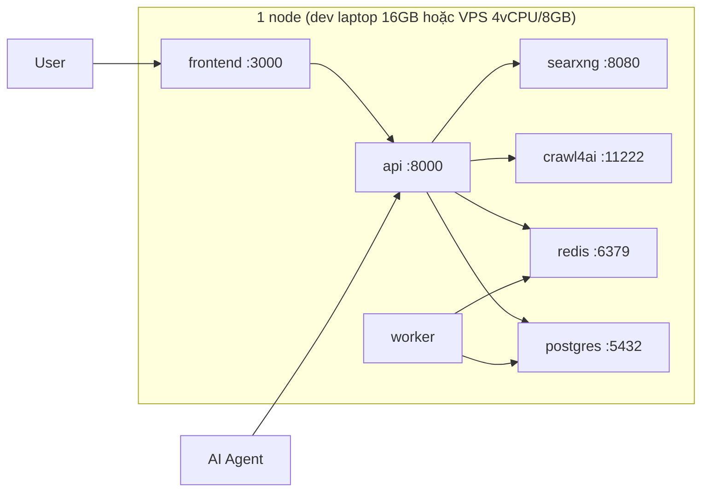

# 08 — Deployment & Operations

## 1. Topology (docker-compose, single node)



- **searxng**: meta-search core (giant #1), `formats: [html, json]`, limiter off (nội bộ).
- **crawl4ai**: extraction service (giant #2), Playwright/Chromium đóng gói sẵn trong image, API `POST /md` — ta không tự cài Chromium.
- **api**: FastAPI orchestration mỏng; dev 16GB chạy 1–2 workers, prod 2×vCPU.
- **worker**: asyncio worker cho deep research + job dọn retention.
- **frontend**: Next.js standalone.
- **postgres**: image `pgvector/pgvector:pg16`.
- **redis**: cache + rate limit + locks.

### Hai profile triển khai

| | **dev-laptop (16GB)** | **prod VPS (4vCPU/8GB)** |
|---|---|---|
| WSL2 | cap 6GB qua `%UserProfile%\.wslconfig` (`memory=6GB, processors=4, swap=2GB`) | — |
| mem_limits | bật (bảng §2, tổng ~4GB) | nới lỏng ×2 |
| api workers | 1–2 | 2×vCPU |
| crawl4ai concurrency | 2, 1 browser instance | 4–6 |
| Observability profile | tắt | bật khi cần |
| LLM | cloud API (Ollama 3B chỉ experimental offline) | cloud API hoặc vLLM/Ollama tự host |

## 2. docker-compose services (xem [deploy/docker-compose.yml](../deploy/docker-compose.yml))

| Service | Image | mem_limit (dev 16GB) | Ghi chú |
|---|---|---|---|
| searxng | searxng/searxng | 512m | mount `deploy/searxng/settings.yml` |
| crawl4ai | ghcr.io/unclecode/crawl4ai:latest | 1.5g | Playwright/Chromium sẵn trong image; concurrency 2 |
| redis | redis:7-alpine | 256m | `--maxmemory 256mb --maxmemory-policy allkeys-lru` |
| postgres | pgvector/pgvector:pg16 | 768m | volume `pgdata`; `shared_buffers=256MB` |
| api | build `./api` | 512m | env từ `.env`; uvicorn 1–2 workers |
| worker | build `./api` | 512m | cùng image, command khác |
| frontend | build `./frontend` | 256m | Next.js standalone |
| (profile: observability) | langfuse, prometheus, grafana | — | bật khi cần (prod) |

## 3. Cấu hình môi trường (xem [deploy/.env.example](../deploy/.env.example))

Bắt buộc: `SEARXNG_URL`, `CRAWL4AI_URL`, `DATABASE_URL`, `REDIS_URL`, `OPENAI_API_KEY` (hoặc `ANTHROPIC_API_KEY`).
Tùy chọn: `TAVILY_API_KEY`, `SERPER_API_KEY`, `BRAVE_API_KEY`, `JINA_API_KEY`, `LANGFUSE_*`.
Secrets: chỉ qua env/secret manager; `.env` không commit (đã gitignore).

## 4. Khởi động

```bash
# (dev laptop 16GB, làm 1 lần) cap WSL2 để không đè Windows:
#   tạo %UserProfile%\.wslconfig với [wsl2] memory=6GB processors=4 swap=2GB rồi `wsl --shutdown`
cd deploy
cp .env.example .env        # điền key
docker compose up -d
docker compose exec api alembic upgrade head
# smoke test
curl http://localhost:8000/readyz
curl -X POST http://localhost:8000/v1/search -H 'Content-Type: application/json' \
  -d '{"query":"thủ đô Việt Nam","lang":"vi","k":5}'
```

## 5. Scaling path

| Giai đoạn | Thay đổi |
|---|---|
| 1 node (mặc định) | compose như trên, 20 RPS |
| Tăng traffic | tách api ra nhiều instance sau Nginx/Caddy; Redis pub/sub cho SSE |
| Reranker nặng | expose reranker thành service riêng (GPU) hoặc dùng API rerank |
| Data lớn | Postgres read replica; partition `search_results` theo tháng |
| Multi-tenant | thêm gateway (Kong/Traefik) + quota per tenant |

## 6. Vận hành

- **Backup**: `pg_dump` nightly → S3/rclone; Redis không cần backup (cache).
- **Log**: stdout JSON → docker logs / Loki; request_id xuyên suốt.
- **Alerts** (Prometheus): error rate > 5% trong 5m; p95 answer > 15s; engine success < 90%; disk > 80%.
- **Cập nhật giants**: `docker compose pull searxng crawl4ai && docker compose up -d searxng crawl4ai` (monthly) — engine upstream đổi cấu trúc chỉ cần nâng image, orchestration không đổi.
- **Retention job** (worker, nightly): xóa `search_results`/`answers` > 90 ngày; vacuum.
- **Health checks**: compose `healthcheck` cho postgres/redis/searxng; api `/readyz` check dependencies.
