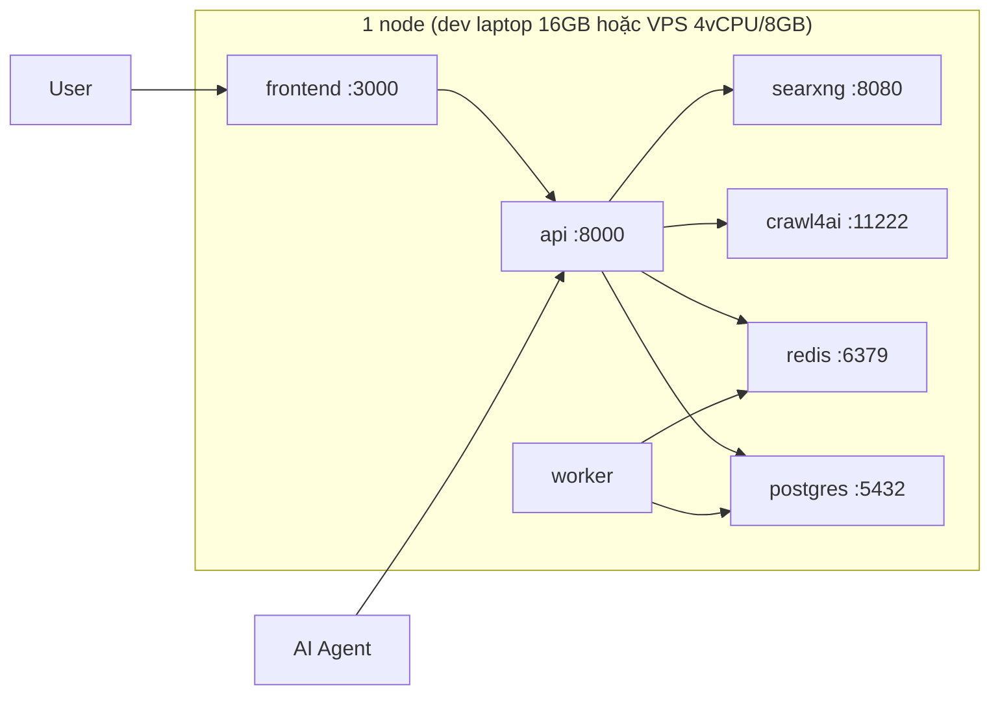

# 08 — Deployment & Operations

## 0 — Lite profile: chạy KHÔNG Docker (máy yếu / laptop 8–16GB)

Từ v0.6.0 toàn bộ tính năng chạy native không container. RAM đo thực tế: **API ~100MB**
(so với ~4GB cho compose stack). Đổi lại: L2 semantic cache tắt (cần pgvector),
JS-rendering phụ thuộc Jina Reader keyless (~20 rpm), engine hot-config lưu
in-memory khi engine store rơi về fallback.

### Khởi động 3 bước

```powershell
cd api
python -m venv .venv && .\.venv\Scripts\python.exe -m pip install -e ".[dev]"
copy ..\deploy\.env.lite.example .env        # điền OPENAI_API_KEY nếu muốn answer
.\.venv\Scripts\python.exe -m uvicorn app.main:app --port 8000
# Swagger: http://localhost:8000/docs — Web UI: cd frontend && npm run dev
```

### Chất lượng đảm bảo thế nào

| Năng lực | Lite profile | Ghi chú |
|---|---|---|
| General search | DuckDuckGo keyless + Tavily/Serper/Brave khi có key | Dedup/consensus/diversity/citation giữ nguyên |
| Academic/reference | arXiv + Wikipedia (theo lang) | Category filter như thường |
| Extraction | trafilatura in-process -> Jina Reader keyless | SSRF guard + pinning + robots + 5MB cap giữ nguyên |
| Persistence | SQLite (WAL) — queries/answers/keys/engine config | Lúc boot chạy `alembic upgrade head` như Postgres; DB cũ tạo bằng `create_all` được bổ sung rồi `stamp head` |
| Cache | `REDIS_URL` trống hoặc Redis chết -> **in-process TTL fallback** (512 entries) | Một tiến trình nên không cần chia sẻ; `/readyz` báo Redis `skipped` |
| Rate limit | Redis -> **local sliding window fallback** | Vẫn chặn 429 khi Redis chết |
| Auth | Đầy đủ (SQLite) | `metasearch keys create` |
| Deep Research / MCP / eval | Đầy đủ | Budget cap như thường |

### Chạy Lite như một dịch vụ trên Windows

Script trong `scripts/windows/`, chạy được trên PowerShell 5.1:

```powershell
# Bật, tắt, xem trạng thái. Chỉ nghe 127.0.0.1, auth bật, từ chối cổng đã có tiến trình khác giữ.
.\scripts\windows\metasearch-lite.ps1 start -Port 8000
.\scripts\windows\metasearch-lite.ps1 status
.\scripts\windows\metasearch-lite.ps1 stop

# Tự khởi động khi đăng nhập, tự chạy lại khi chết, tự kiểm /readyz mỗi 5 phút và khi máy thức dậy.
.\scripts\windows\install-task.ps1 -Port 8000
.\scripts\windows\install-task.ps1 -Remove
```

- Log ở `api\.lite.log`, `api\.lite.err.log`, xoay khi quá 10 MB; nhật ký của script ở `api\.lite.manager.log`.
- `check` khởi động lại dịch vụ khi `/readyz` không trả 200 trong 30 giây.
- Đo trên máy chạy thật (`04-quality-checklist` C11-C13): `measure-lite.ps1 idle`, `restart`, và `wake` sau mỗi lần máy thức. Kết quả nối vào `api\.lite.measure.log`.

### `/readyz`

| Trạng thái | HTTP | Nghĩa |
|---|---|---|
| `ready` | 200 | Mọi phụ thuộc trả lời |
| `degraded` | 200 (503 với `?strict=true`) | Một phụ thuộc vắng mặt, search vẫn chạy |
| `not_ready` | 503 | Không còn engine nào vừa có adapter vừa đang bật |
| `shutting_down` | 503 | Tiến trình đang tắt |

Mỗi phụ thuộc được hỏi trong tối đa `READINESS_TIMEOUT_S` (mặc định 2 s). `schema_version` là revision Alembic mà bản build mang theo.

### Khi nào cần Docker trở lại

- Cần SearXNG consensus 70+ engines / JS crawl4ai render / pgvector L2 cache /
  shared Redis rate limit multi-worker -> dùng compose profile đầy đủ.
- Cả hai profile dùng chung code; chuyển bằng env vars, không có branch riêng.


## 1. Topology (docker-compose, single node)



- **searxng**: meta-search core (giant #1), `formats: [html, json]`, limiter off (nội bộ).
- **crawl4ai**: extraction service (giant #2), Playwright/Chromium đóng gói sẵn trong image, API `POST /md` — ta không tự cài Chromium.
- **api**: FastAPI orchestration mỏng; một tiến trình uvicorn (`--workers 1`): breaker, admission, gộp request trùng và rate limit dự phòng là trạng thái trong tiến trình, nhiều worker sẽ chia nhỏ chúng.
- **worker**: asyncio worker cho deep research.
- **frontend**: Next.js standalone.
- **postgres**: image `pgvector/pgvector:pg16`.
- **redis**: cache + rate limit + locks.

### Hai profile triển khai

| | **dev-laptop (16GB)** | **prod VPS (4vCPU/8GB)** |
|---|---|---|
| WSL2 | cap 6GB qua `%UserProfile%\.wslconfig` (`memory=6GB, processors=4, swap=2GB`) | — |
| mem_limits | bật (bảng §2, tổng ~4GB) | nới lỏng ×2 |
| api workers | 1 | 1 (scale bằng nhiều instance sau khi đưa trạng thái ra Redis, chưa làm) |
| crawl4ai concurrency | 2, 1 browser instance | 4–6 |
| Observability profile | tắt | bật khi cần |
| LLM | cloud API (Ollama 3B chỉ experimental offline) | cloud API hoặc vLLM/Ollama tự host |

## 2. docker-compose services (xem [deploy/docker-compose.yml](../deploy/docker-compose.yml))

| Service | Image | mem_limit (dev 16GB) | Ghi chú |
|---|---|---|---|
| searxng | searxng/searxng | 512m | mount `deploy/searxng/settings.yml` |
| crawl4ai | ghcr.io/unclecode/crawl4ai:latest | 1.5g | Playwright/Chromium sẵn trong image; concurrency 2 |
| redis | redis:7-alpine | 256m | `--maxmemory 256mb --maxmemory-policy allkeys-lru` |
| postgres | pgvector/pgvector:pg16 | 768m | volume `pgdata`; `shared_buffers=256MB` |
| api | build `./api` | 512m | env từ `.env`; uvicorn `--workers 1` |
| worker | build `./api` | 512m | cùng image, command khác |
| frontend | build `./frontend` | 256m | Next.js standalone |
| (profile: observability) | langfuse, prometheus, grafana | — | bật khi cần (prod) |

## 3. Cấu hình môi trường (xem [deploy/.env.example](../deploy/.env.example))

Bắt buộc: `SEARXNG_URL`, `CRAWL4AI_URL`, `DATABASE_URL`, `REDIS_URL`, `OPENAI_API_KEY` (hoặc `ANTHROPIC_API_KEY`).
Tùy chọn: `TAVILY_API_KEY`, `SERPER_API_KEY`, `BRAVE_API_KEY`, `JINA_API_KEY`, `LANGFUSE_*`.
Secrets: chỉ qua env/secret manager; `.env` không commit (đã gitignore).

## 4. Khởi động

```bash
# (dev laptop 16GB, làm 1 lần) cap WSL2 để không đè Windows:
#   tạo %UserProfile%\.wslconfig với [wsl2] memory=6GB processors=4 swap=2GB rồi `wsl --shutdown`
cd deploy
cp .env.example .env        # điền key
docker compose up -d
docker compose exec api alembic upgrade head
# smoke test
curl http://localhost:8000/readyz
curl -X POST http://localhost:8000/v1/search -H 'Content-Type: application/json' \
  -d '{"query":"thủ đô Việt Nam","lang":"vi","k":5}'
```

## 5. Scaling path

| Giai đoạn | Thay đổi |
|---|---|
| 1 node (mặc định) | compose như trên, 20 RPS |
| Tăng traffic | tách api ra nhiều instance sau Nginx/Caddy; Redis pub/sub cho SSE |
| Reranker nặng | expose reranker thành service riêng (GPU) hoặc dùng API rerank |
| Data lớn | Postgres read replica; partition `search_results` theo tháng |
| Multi-tenant | thêm gateway (Kong/Traefik) + quota per tenant |

## 6. Vận hành

- **Backup**: `pg_dump` nightly → S3/rclone; Redis không cần backup (cache).
- **Log**: stdout JSON → docker logs / Loki; request_id xuyên suốt.
- **Alerts** (Prometheus, `deploy/prometheus/alerts.yml`): lỗi 5xx > 5% trong 5 phút; p95 answer > 15 s; event loop p99 > 250 ms; breaker mở > 10 phút; hàng đợi persist > 500, ghi bị bỏ, ghi lỗi > 10/15 phút. Chưa có alert disk (để cho node exporter).
- **Cập nhật giants**: `docker compose pull searxng crawl4ai && docker compose up -d searxng crawl4ai` (monthly) — engine upstream đổi cấu trúc chỉ cần nâng image, orchestration không đổi.
- **Retention**: Lite chạy trong tiến trình API mỗi `RETENTION_INTERVAL_S` (mặc định 3600 s). Postgres chưa có job tự chạy: đặt cron `python -m app.cli retention` (thử trước với `--dry-run`). Thời hạn (`RETENTION_DAYS`): queries, search_results, answers, citations 90 ngày; nội dung chunk 30 ngày (giữ hàng cho citation); engine_health 14 ngày.
- **Health checks**: compose `healthcheck` cho postgres/redis/searxng; api `/readyz` check dependencies.
