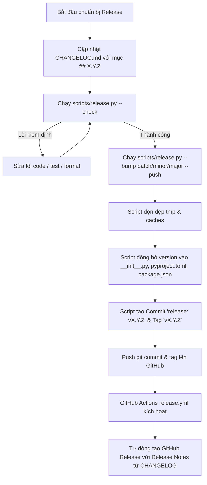

# 13 — Versioning, Quality Gates & Release Management

Tài liệu này quy định chuẩn mực quản trị phiên bản (Versioning), hệ thống kiểm soát chất lượng (Quality Gates) và quy trình phát hành (Release & Publishing Pipeline) cho MetaSearch.

---

## 1. Nguyên Tắc Cốt Lõi (Core Principles)

1. **Semantic Versioning 2.0.0 (SemVer)**:
   - Cấu trúc phiên bản: `MAJOR.MINOR.PATCH[-PRERELEASE]`.
   - `MAJOR` (x.0.0): Thay đổi phá vỡ tương thích ngược (Breaking Changes) ở REST API, MCP schema, hoặc pipeline core.
   - `MINOR` (1.x.0): Bổ sung tính năng mới, Search Adapter mới, mở rộng chỉ báo phân tích hoặc hồ sơ nghiên cứu mà vẫn tương thích ngược.
   - `PATCH` (1.0.x): Sửa lỗi (bug fixes), tối ưu hóa hiệu năng, cập nhật bảo mật hoặc tài liệu.
2. **Single Source of Truth & Synchronization**:
   - Toàn bộ phiên bản được đồng bộ nguyên tử (Atomic Synchronization) trên 3 tệp cấu hình cốt lõi:
     - `api/app/__init__.py` (`__version__ = "X.Y.Z"`)
     - `api/pyproject.toml` (`version = "X.Y.Z"`)
     - `frontend/package.json` (`"version": "X.Y.Z"`)
3. **No Release Without Cleanliness & Green Gates**:
   - Không được phép tạo bản phát hành khi còn tồn dư file rác, file tạm (`.db`, `.tmp`, cache), hoặc khi có bất kỳ cảnh báo/lỗi nào từ linter, security scan, unit tests hay build frontend.
4. **Keep a Changelog Enforced**:
   - Mọi phiên bản phát hành bắt buộc phải có mục tài liệu tương ứng tại `CHANGELOG.md` theo định dạng `## [X.Y.Z] — YYYY-MM-DD` với các mục phân loại rõ ràng (`Added`, `Changed`, `Deprecated`, `Removed`, `Fixed`, `Security`).

---

## 2. Các Cổng Kiểm Định Chất Lượng Bắt Buộc (Quality & Pre-Commit Gates)

Trước khi commit hoặc phát hành, pipeline và Git hook tự động thực thi tuần tự 7 bước kiểm tra bắt buộc (nghiêm cấm mọi lệnh `git commit` nếu có bất kỳ lỗi nào):

| Cổng kiểm định | Công cụ & Lệnh | Tiêu chí chấp nhận |
|---|---|---|
| **1. Cleanliness** | `scripts/release.py --clean-only` | Xóa sạch `*.db*`, `*.tmp`, `*.log`, `.ruff_cache`, `.pytest_cache`, `.next`, `tsconfig.tsbuildinfo`, `__pycache__` |
| **2. Code Formatting** | `ruff format --check api/app api/tests scripts` | 0 file cần format lại |
| **3. Static Analysis & Lint** | `ruff check api/app api/tests scripts` | 0 cảnh báo / 0 lỗi linting |
| **4. Security AST Audit** | `bandit -q -r api/app -x api/tests` | 0 lỗ hổng bảo mật (Exit code 0) |
| **5. E2E Full System Suite**| `pytest api/tests/test_e2e_full_system.py -q` | 100% End-to-End tests PASS (20 presets, 8 domains, Council, Dream-RSI, SSE) |
| **6. Backend Full Test Suite**| `pytest api/tests -q` | 100% tests PASS (366+ unit & integration tests) |
| **7. Frontend Typecheck & Build**| `npm run typecheck` + `npm run build` | TypeScript sạch, Next.js static production build thành công |

### Cưỡng Chế Git Pre-Commit Hook (`.githooks/pre-commit`)
MetaSearch thiết lập pre-commit hook tại `.githooks/pre-commit`:
```bash
git config core.hooksPath .githooks
```
Mỗi khi lập trình viên thực hiện `git commit`, hook sẽ tự động chạy `python scripts/release.py --pre-commit-gate`. Nếu có bất kỳ bài test nào (kể cả E2E hay Unit) bị fail, lệnh commit sẽ bị hủy bỏ ngay lập tức.

---

## 3. Công Cụ Tự Động Hóa `scripts/release.py`

MetaSearch cung cấp script tự động hóa chuẩn mực tại `scripts/release.py` (chạy độc lập bằng Python thuần, tương thích Windows/Linux/macOS):

```bash
# 1. Dọn dẹp sạch workspace (caches, tmp, test dbs):
python scripts/release.py --clean-only

# 2. Kiểm tra toàn bộ Quality Gates & tính toàn vẹn của version/changelog (Dry-run):
python scripts/release.py --check

# 3. Trích xuất ghi chú phát hành (Release Notes) từ CHANGELOG.md:
python scripts/release.py --notes

# 4. Tăng phiên bản tự động (patch: 1.0.0 -> 1.0.1, minor: 1.0.0 -> 1.1.0, major: 1.0.0 -> 2.0.0):
python scripts/release.py --bump patch

# 5. Hoặc chỉ định phiên bản mục tiêu cụ thể:
python scripts/release.py --version 1.0.1

# 6. Tự động chạy clean, test, cập nhật 3 files version, commit git, tạo tag và push lên remote:
python scripts/release.py --bump patch --push
```

### Các cờ hỗ trợ:
- `--dry-run`: Chạy thử toàn bộ quy trình mà không ghi đè file hay tạo commit git thật.
- `--skip-tests`: (Chỉ dùng trong tình huống cứu hộ khẩn cấp) bỏ qua bước chạy test suite dài.
- `--push`: Tự động đẩy git commit và git annotated tag lên remote (`origin main --follow-tags`).

---

## 4. Quy Trình Phát Hành Phiên Bản Chuẩn (Standard Release Workflow)



### Bước 1: Chuẩn bị nội dung thay đổi
Mở `CHANGELOG.md` và thêm tiêu đề phiên bản mới nhất ngay trên đầu:
```markdown
## [1.0.1] — 2026-11-02 — Tên phiên bản / Tóm tắt trọng tâm

### Added
- Tính năng mới A...

### Fixed
- Vá lỗi B...
```

### Bước 2: Chạy kiểm định cục bộ
```bash
python scripts/release.py --check
```

### Bước 3: Đóng gói và phát hành
```bash
python scripts/release.py --bump patch --push
```

---

## 5. Tự Động Hóa CI/CD Đa Nền Tảng Trên GitHub Actions (`ci.yml` & `release.yml`)

MetaSearch thực thi kiểm định liên tục **Multi-Platform Matrix** trên **mọi commit** và **mọi pull request** (bao gồm cả Linux, Windows và macOS):

### A. CI Workflow Đa Nền Tảng (`.github/workflows/ci.yml`)
- **Triggers**: Tự động chạy trên mọi commit được push lên bất kỳ nhánh nào (`branches: ["**"]`) và mọi pull request.
- **Matrix Nền tảng**:
  - `ubuntu-latest` (Linux x86_64)
  - `windows-latest` (Windows Server)
  - `macos-latest` (macOS Apple Silicon / ARM64 & Intel)
- **Các Job kiểm định độc lập**:
  1. `backend-matrix`: Kiểm tra Ruff format, Ruff lint, Bandit AST security scan, bộ kiểm thử toàn trình E2E (`test_e2e_full_system.py`), và toàn bộ unit test suite (`pytest tests -q`).
  2. `frontend-matrix`: Kiểm tra nghiêm ngặt kiểu dữ liệu TypeScript (`npm run typecheck`) và biên dịch Next.js production build (`npm run build`).
  3. `release-pipeline-gate`: Tích hợp cả Python 3.12 và Node.js 22 trên cả 3 hệ điều hành để chạy `python scripts/release.py --check` trong môi trường hoàn toàn độc lập và sạch sẽ.
  4. `docker-build-smoke`: Kiểm tra tính toàn vẹn của Dockerfile API và Dockerfile Frontend trên môi trường Linux container.

### B. Release Workflow (`.github/workflows/release.yml`)
Khi một Git tag có dạng `v*.*.*` được push lên repository:
1. Workflow `.github/workflows/release.yml` khởi chạy.
2. Kiểm tra chéo lại toàn bộ Quality Gates trong môi trường sạch.
3. Tự động trích xuất nội dung `Release Notes` của phiên bản đó từ `CHANGELOG.md`.
4. Tạo bản phát hành **GitHub Release** chính thức kèm đính kèm mã nguồn và release notes định dạng Markdown sắc nét.

---

## 6. Quy Trình Rollback Khẩn Cấp (Emergency Rollback)

Nếu một bản phát hành gặp sự cố ngoài dự kiến trên production:
1. Xác định tag lỗi (ví dụ `v1.0.1`).
2. Revert release commit:
   ```bash
   git revert HEAD -m "revert: rollback release v1.0.1 due to issue #..."
   ```
3. Xóa tag cục bộ và remote (nếu cần thu hồi):
   ```bash
   git tag -d v1.0.1
   git push origin :refs/tags/v1.0.1
   ```
4. Bumping hotfix patch version (ví dụ `v1.0.2`) sau khi khắc phục và thực thi lại quy trình phát hành chuẩn.
