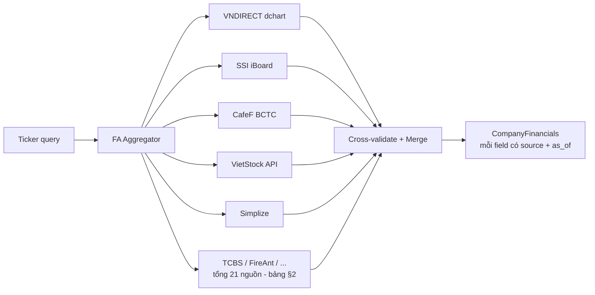

# 15 — Multi-Source FA Integration Plan

> Mục tiêu: giảm phụ thuộc vào VNDIRECT (single point of failure) bằng cách
> thêm nhiều nguồn FA độc lập, cross-validate, và fallback gracefully.

## 1. Kiến trúc



## 2. Nguồn FA khả dụng

| # | Nguồn | Loại data | Endpoint | Auth | Độ tin cậy | Ghi chú |
|---|---|---|---|---|---|---|
| 1 | **VNDIRECT dchart** | OHLCV | `dchart-api.vndirect.com.vn/dchart/history` | Keyless | Cao | Hiện có |
| 2 | **Simplize** | FA summary | `api.simplize.vn/api/company/summary` | Keyless | Trung bình | Hiện có |
| 3 | **SSI iBoard** | OHLCV + market depth | `iboard.ssi.com.vn/dchart/api/history` | Keyless | Cao | Cùng format TradingView |
| 4 | **CafeF** | BCTC, ratios, company profile | `s.cafef.vn/du-lieu/Lich-su-gia/{SYM}-1.chn` + `s.cafef.vn/thong-ke/{SYM}` | Keyless (scrape) | Cao | HTML tables cần parse |
| 5 | **VietStock** | BCTC chi tiết, Plan vs Actual | `api.vietstock.vn/v1/finance/{SYM}` | Cần token | Cao | Đã có reference trong code |
| 6 | **Stockbiz** | Financial ratios, profiles | `stockbiz.vn/{SYM}` | Keyless (scrape) | Trung bình | HTML scraping |
| 7 | **FPTS/FPTS.vn** | FA data, charts | `fpts.com.vn` | Keyless | Trung bình | Ít docs hơn |
| 8 | **TCBS (Techcom Securities)** | FA ratios, BCTC, charts | `api.tcbs.com.vn/stock-insight/v1/stock/{SYM}/financial-ratio?period=1&size=100&isAll=true` | Keyless (API nội bộ) | Cao | API nội bộ của web TCBS, KHÔNG có docs chính thức; trả JSON chuỗi tỷ số PE/PB/ROE/ROA/EPS/growth theo năm/quý; schema chốt sau khi probe |
| 9 | **FireAnt** | Income statement, balance sheet, cash flow | `restv2.fireant.vn/api/companies/{SYM}/income-statement` + `/balance-sheet` + `/cash-flow?quarterCount=4&years=0` | Bearer JWT (login fireant.vn) | Cao | API nội bộ platform FireAnt (đã kiểm chứng qua cộng đồng); token trong env `FA_FIREANT_TOKEN`, không hardcode |
| 10 | **WSS** | Company profile, FA ratios | `wss.vn/co-phieu/{SYM}` | Keyless (scrape) | Trung bình | HTML scraping |
| 11 | **MAS Group (Chứng khoán MAS)** | FA data, research reports | `masvn.com/{SYM}` | Keyless (scrape) | Trung bình | HTML scraping |
| 12 | **Vietcap** | FA data, company profile | `vietcap.com.vn/co-phieu/{SYM}` | Keyless (scrape) | Trung bình | HTML scraping |
| 13 | **VPS SmartAPI** | Full market data, OHLCV, FA | `smart-api.vps.com.vn` | Cần API key (đăng ký miễn phí) | Cao | REST JSON API, chi tiết nhất |
| 14 | **BSC (Bảo Việt Chứng khoán)** | Research reports, FA | `bsc.com.vn` | Keyless (download) | Cao | PDF reports, cần parse |
| 15 | **SHS (Sài Gòn - Hà Nội CK)** | FA data, company profile | `shs.com.vn` | Keyless (scrape) | Trung bình | HTML scraping |
| 16 | **Agribank Securities (Agriseco)** | FA data, research | `agriseco.com.vn` | Keyless (scrape) | Trung bình | HTML scraping |
| 17 | **VNDIRECT Economic Dashboard** | Macro data, interest rates | `vndirect.com.vn/portal/bieu-do-kinh-te-vi-mo` | Keyless (scrape) | Cao | Macro indicators: GDP, CPI, interest rates |
| 18 | **SBV (Ngân hàng Nhà nước)** | Interest rates, exchange rates, reserve requirements | `sbv.gov.vn` | Keyless (scrape/API) | Cao | Official macro data |
| 19 | **GSO (Tổng cục Thống kê)** | GDP, CPI, IIP, PMI | `gso.gov.vn` | Keyless (scrape/API) | Cao | Official macro indicators |
| 20 | **HOSE Official** | Official market data, listing info | `hose.com.vn` | Keyless (API) | Cao | Official exchange data |
| 21 | **HNX Official** | Official market data (HNX + UPCOM) | `hnx.vn` | Keyless (API) | Cao | Official exchange data |

## 3. Thiết kế kỹ thuật

### 3.1. Protocol `FASource` (giống `SearchAdapter`)

```python
class FASource(Protocol):
    source_id: str
    priority: float  # 1.0 = cao nhất

    async def fetch_financials(self, symbol: str, **kw) -> CompanyFinancials: ...
    async def fetch_ohlcv(self, symbol: str, **kw) -> list[dict]: ...
    async def health_check(self) -> bool: ...
```

**Quy tắc xây dựng adapter — tự gọi trực tiếp, KHÔNG qua thư viện trung gian:**

- Mỗi nguồn là một module tự chứa, gọi endpoint trực tiếp bằng `httpx` qua pool
  dùng chung `app/http.py` (`search` hoặc `scrape`), tự parse JSON/HTML riêng.
- **Cấm phụ thuộc vnstock / vnquant / wrapper tương tự**: wrapper là một dependency
  trung gian chết theo cả 21 nguồn cùng lúc, che khuất endpoint thật, và kéo theo
  các dep lạ (pandas, lxml bản cứng). Adapter riêng thì breaker/fallback/unit test
  bọc từng nguồn độc lập — đúng pattern `SearchAdapter` hiện có.
- Header mimic browser khi gọi API nội bộ (TCBS, FireAnt): `User-Agent`, `Accept:
  application/json`; 401/403 → `Outcome.RATE_LIMITED` + mark token stale, không retry vô hạn.
- URL nguồn FA là hardcode từ tài liệu này (không phải user-supplied) → vẫn đi qua
  `ssrf.resolve_and_check` theo quy ước chung, nhưng không cần thêm whitelist runtime.

### 3.2. `FAAggregator` — fan-out + cross-validate + merge

```python
class FAAggregator:
    """Fan-out tới tất cả nguồn, cross-validate, merge vào CompanyFinancials."""
    sources: list[FASource]

    async def fetch(self, symbol: str) -> AggregatedFinancials:
        # 1. Fan-out concurrently với per-source timeout
        # 2. Cross-validate: field trùng nhau từ ≥2 nguồn → confidence cao
        # 3. Merge: ưu tiên nguồn có priority cao, field thiếu lấy từ nguồn khác
        # 4. Tag: mỗi field có {value, source, as_of}
```

### 3.3. Cross-validation rules

| Rule | Mô tả |
|---|---|
| **Consensus** | Field có giá trị giống nhau từ ≥2 nguồn → `validated=true` |
| **Conflict** | Field có giá trị khác nhau → ưu tiên nguồn priority cao, log `fa_conflict` |
| **Singleton** | Field chỉ có từ 1 nguồn → `validated=false`, đánh dấu để theo dõi |
| **Missing** | Field không có từ nguồn nào → `None` + `missing_fields` list |

### 3.4. Source health tracking

Tái sử dụng `EngineBreaker` từ `health.py`:
- 3 lỗi liên tiếp → breaker mở → skip nguồn đó
- Recovery probe mỗi 5 phút
- Metric: `metasearch_fa_source_state{source="ssi"}`

## 4. Implementation plan (theo thứ tự ưu tiên)

### Wave 1 — Core infrastructure (ngay)

| Task | File | Mô tả |
|---|---|---|
| 1.1 | `app/retrieval/fa_sources/base.py` | Protocol `FASource` + `SourceResponse` |
| 1.2 | `app/retrieval/fa_sources/ssi.py` | SSI iBoard OHLCV adapter |
| 1.3 | `app/retrieval/fa_sources/aggregator.py` | FAAggregator + cross-validate |
| 1.4 | `app/retrieval/fa_sources/__init__.py` | Package init |
| 1.5 | Tests | Unit tests cho từng source + aggregator |

### Wave 2 — Thêm nguồn JSON (sau Wave 1)

| Task | File | Mô tả |
|---|---|---|
| 2.1 | `app/retrieval/fa_sources/tcbs.py` | TCBS financial-ratio JSON (gọi trực tiếp, keyless) |
| 2.2 | `app/retrieval/fa_sources/fireant.py` | FireAnt 3 báo cáo tài chính JSON (Bearer JWT từ env) |
| 2.3 | `app/retrieval/fa_sources/cafef.py` | CafeF BCTC scraper |
| 2.4 | `app/retrieval/fa_sources/vietstock_api.py` | VietStock API (cần token) |
| 2.5 | Health tracking | Breaker per FA source |
| 2.6 | Tests | Unit + integration (respx fake từng endpoint) |

### Wave 3 — Tối ưu (sau Wave 2)

| Task | Mô tả |
|---|---|
| 3.1 | Cache FA data theo TTL (field-level, không phải source-level) |
| 3.2 | Batch fetch nhiều tickers concurrently |
| 3.3 | Lưu FA snapshot vào zvec/DB để tránh re-fetch |

## 5. Chi tiết từng nguồn

### 5.1. SSI iBoard (`iboard.ssi.com.vn`)

```
GET https://iboard.ssi.com.vn/dchart/api/history?symbol=HQC&resolution=D&from={unix_from}&to={unix_to}
Response: { "s": "ok", "t": [unix_ts...], "o": [open...], "h": [high...], "l": [low...], "c": [close...], "v": [volume...] }
```

- Cùng format với VNDIRECT dchart (cả hai dùng TradingView charting library)
- Không cần auth
- Rate limit: chưa xác nhận (cần probe)
- Confidence: cao (SSI là chứng khoán lớn nhất VN)

### 5.2. CafeF BCTC

```
GET https://s.cafef.vn/Ajax/PageNew/DataHistory/PriceHistory.ashx?Symbol=HQC&StartDate=&EndDate=
GET https://s.cafef.vn/du-lieu/bao-cao-tai-chinh/{SYM}/bao-cao-ket-qua-kinh-doanh
```

- BCTC: HTML tables cần parse (BeautifulSoup hoặc lxml)
- Không cần auth (keyless scrape)
- Rate limit: cẩn thận, scrape nhẹ nhàng

### 5.3. VietStock API

```
POST https://api.vietstock.vn/v1/user/login (để lấy token)
GET https://api.vietstock.vn/v1/finance/balance-sheet?symbol=HQC
```

- Cần đăng ký tài khoản miễn phí để lấy token
- Token có thời hạn, cần refresh
- Data chi tiết nhất trong các nguồn public

### 5.4. TCBS — gọi trực tiếp (không qua vnstock)

```
GET https://api.tcbs.com.vn/stock-insight/v1/stock/{SYM}/financial-ratio?period=1&size=100&isAll=true
```

- `period`: `1` = theo năm, `4` = theo quý; `isAll=true` trả toàn bộ lịch sử
- Trả JSON chuỗi thời gian các tỷ số (PE, PB, ROE, ROA, EPS, tăng trưởng doanh
  thu/lợi nhuận, nợ/vốn...) — schema field name chính xác chốt sau khi probe 1 lần
- Là API nội bộ của web TCBS (không có docs chính thức): header mimic browser,
  breaker sẵn sàng ngắt khi đổi schema; không gọi qua vnstock — adapter tự gọi,
  tự parse, tự test với respx fake

### 5.5. FireAnt — gọi trực tiếp (không qua vnstock)

```
GET https://restv2.fireant.vn/api/companies/{SYM}/income-statement?quarterCount=4&years=0
GET https://restv2.fireant.vn/api/companies/{SYM}/balance-sheet?quarterCount=4&years=0
GET https://restv2.fireant.vn/api/companies/{SYM}/cash-flow?quarterCount=4&years=0
Authorization: Bearer {JWT}
```

- `quarterCount` = số quý gần nhất, `years=0` = chỉ lấy theo quý
- Đã triển khai: income-statement + balance-sheet (2 fetch song song); cash-flow
  endpoint có sẵn khi cần — hiện chưa map vào canonical fields (docs/15 §8.1
  ghi 3 statement là mục tiêu, hiện trạng là 2)
- JWT lấy từ login fireant.vn, đặt trong env `FA_FIREANT_TOKEN` (không hardcode,
  không commit); 401/403 → breaker record + mark token stale để chủ cấp lại
- Cùng pattern như TCBS: tự gọi httpx, tự parse, respx fake trong unit test

## 6. Ước lượng

| Phase | Thời gian | Số file mới | Số dòng ước tính |
|---|---|---|---|
| Wave 1 | 2-3 giờ | 4 files | ~400 dòng |
| Wave 2 | 3-4 giờ | 4 files | ~500 dòng |
| Wave 3 | 1-2 giờ | 0 files mới | ~100 dòng sửa |

## 7. Risk assessment

| Risk | Impact | Mitigation |
|---|---|---|
| SSI iBoard đổi API format | Search fail cho SSI source | Breaker auto-disable, fallback sang VNDIRECT |
| CafeF block scrape | Không có BCTC data | Retry với delay, hoặc dùng VietStock API |
| VietStock token expire | FA data fail | Token refresh tự động |
| FireAnt JWT hết hạn | Không có 3 báo cáo tài chính từ FireAnt | Env `FA_FIREANT_TOKEN` cấp lại; breaker skip nguồn, các nguồn khác gánh |
| API nội bộ (TCBS/FireAnt) đổi path/schema | Source fail | Breaker auto-disable + cross-validate từ nguồn khác; probe lại schema rồi fuse |
| Nguồn trả data không khớp | FA ratios sai | Cross-validation + `validated` flag |
| Tất cả nguồn cùng fail | Không có FA data | Return `None` + `missing_fields` (không hallucinate) |

## 8. Solution chốt triển khai (Wave 1+2)

### 8.1. Package `app/retrieval/fa_sources/` — adapter trực tiếp từng nguồn

| File | Nội dung |
|---|---|
| `base.py` | `FASource` Protocol; `SourceFinancials` / `SourceOHLCV` (payload chuẩn hóa 1 nguồn); `FASourceError` (lỗi nguồn có Outcome để breaker ghi điểm); helper `pick()` (chọn key theo nhiều biến thể tên, case-insensitive) + `_to_float()` (chặn bool/NaN/inf); `CANONICAL_FA_FIELDS` |
| `ssi.py` | `SSIFASource` — GET `iboard.ssi.com.vn/dchart/api/history` (TradingView format `{s,t,o,h,l,c,v}`); OHLCV-only (`fetch_financials` → None); KHÔNG áp hệ số ×1000 của VNDIRECT (feed SSI là VND gốc, không có bằng chứng scale) |
| `tcbs.py` | `TCBSFASource` — GET `api.tcbs.com.vn/stock-insight/v1/stock/{SYM}/financial-ratio?period=1&size=100&isAll=true`; keyless; map phòng thủ qua biến thể key (`pe/priceToEarning`, `roe/roea`, `roa/roaa`,...), key lạ → bỏ qua tuyệt đối; as_of từ trường ngày trong record, không có → None |
| `fireant.py` | `FireAntFASource` — 3 BCTC `restv2.fireant.vn/api/companies/{SYM}/{income-statement,balance-sheet,cash-flow}`; `Authorization: Bearer` từ settings `fa_fireant_token`; token rỗng → nguồn tự tắt; 401/403 → `FASourceError(RATE_LIMITED)`; D/E tính từ totalDebt/totalEquity thật (số học trên số liệu có nguồn) |
| `aggregator.py` | `FAAggregator` — fan-out breaker-gated (`fa:{source_id}`), per-source timeout, merge theo priority; field trùng ≥2 nguồn trong dung sai 0.5% → `validated=true`; xung đột → ưu tiên priority + log `fa_conflict`; tất cả fail → fields rỗng + `missing_fields` (không hallucinate); `fetch_ohlcv` lấy nguồn priority cao nhất thành công |

### 8.2. Tích hợp vào `VietStockAdapter` (vị trí duy nhất dùng FA)

- **OHLCV**: VNDIRECT vẫn là primary. Khi VNDIRECT fail → `aggregator.fetch_ohlcv()`
  (fan-out SSI...) → chuẩn hóa về tuple `(o,h,l,c,v,last_ts)` của đường cũ.
- **FA**: Simplize vẫn là primary. Khi Simplize fail → `aggregator.fetch_financials()`
  → `_build_financials_from_aggregated()` dựng `CompanyFinancials` chỉ từ field
  có thật; `name`/`exchange` tra từ registry `vn_tickers.json` (DAT-06), thiếu thì
  dùng nhãn mặc định ("Công ty Cổ phần {sym}" / "VN") đúng quy ước đường Simplize;
  `has_full_statements=False` (pháp y cần BCTC đầy đủ —
  không chạy trên ratio rời rạc); `source_name="FA-Aggregator(...)"` + provenance
  nguồn trong result.
- **Latency**: aggregator chỉ chạy trên đường fallback (không tăng độ trễ happy
  path); cross-validate thường trực Simplize↔TCBS để dành Wave 3.
- **Breaker/metric**: tái dùng `EngineBreakerRegistry`, tên `fa:ssi|tcbs|fireant`
  → tự export `metasearch_breaker_state{engine="fa:..."}`; EMPTY không tính lỗi,
  UPSTREAM_ERROR/TIMEOUT/RATE_LIMITED tính — 3 lỗi liên tiếp → mở, probe nửa cửa.
- **Config**: thêm `fa_fireant_token` (env `FA_FIREANT_TOKEN`, mặc định rỗng =
  FireAnt tắt); không có key mới nào khác.
- **Cấm vnstock/vnquant**: mỗi nguồn tự gọi httpx qua pool `search`, tự parse,
  unit test fake bằng `httpx.MockTransport` (inject qua constructor `client=`).

## 9. Trạng thái triển khai

| Wave | Trạng thái |
|---|---|
| Wave 1 (base + ssi + aggregator + tests) | ✅ |
| Wave 2 (tcbs + fireant + breaker + tests) | ✅ (cafef/vietstock_api scraper để Wave 2b — cần probe HTML schema live trước khi parse, tránh parse đoán mò) |
| Tích hợp vào VietStockAdapter (fallback) | ✅ |
| Wave 3 (TTL cache, batch, snapshot) | ⏭ |

## 10. Bằng chứng probe live (2026-11-11, egress máy chủ dự án)

| Endpoint | Kết quả | Hệ quả thiết kế |
|---|---|---|
| `dchart-api.vndirect.com.vn/dchart/history` (HPG, SHB) | 200 JSON `{"s":"ok"}`; HPG close 21.25 = 21.250đ thật → **feed scaled ÷1000** | Heuristic ×1000 của đường primary là ĐÚNG (đã có bằng chứng); log khi kích hoạt + cross-check so với Simplize `priceClose` (`fa_price_mismatch`) |
| `iboard.ssi.com.vn/dchart/api/history` | 200 **text/html** (SPA shell) trên cả 2 biến thể path | Adapter fail `bad_json` → breaker mở, graceful; **cần xác minh lại route SSI từ egress sản xuất**, chỉ cần sửa `DEFAULT_BASE_URL` khi tìm ra |
| `api.tcbs.com.vn` | **DNS không phân giải** từ egress này; `apipubaws.tcbs.com.vn` (host trong hệ sinh thái) trả **Cloudflare challenge** | Adapter keyless giữ nguyên; challenge/HTML → `bad_json` → breaker mở. Khi có route thật, chốt schema + đơn vị (`marketCap` VND hay tỷ đ) theo §5.4 |
| `restv2.fireant.vn` | Cần JWT — đúng thiết kế token-gated, không probe được khi chưa có token | Giữ nguyên |

**Nguyên tắc đã cài theo audit vòng 2:** mọi giá trị từ API nội bộ đều qua gate
hợp lý (`fa_suspect_unit`) — TCBS: ROE/ROA trong ±200%, market cap trong
[5, 3.000.000] tỷ đ, EPS trong ±1.000.000đ; FireAnt: mọi khoản `_vnd_bil` trong
[0, 3.000.000] tỷ đ, growth trong ±500%; khi có giá + P/E thì đối chiếu implied
EPS = giá/P/E (lệch >3x là bỏ); nến NaN/âm bị từ chối; mảng o/h/l/v thiếu là từ
chối cả chuỗi (không thay bằng close); mốc `as_of` = cuối kỳ còn `published_at` =
ngày công bố — hai mốc không bao giờ gộp. Fallback chỉ nhận **phần ngân sách còn
lại** của leg (primaries đã tốn bao nhiêu, fallback nhận phần đó trừ biên; sàn
0.5s — hết ngân sách thì bỏ fallback thay vì để pipeline hủy và tính TIMEOUT).

Sources: [vnstock](https://github.com/thinh-vu/vnstock), [SSI TradingView chart](https://www.ssi.com.vn/en/individual-customer/en-tradingview-chart)

