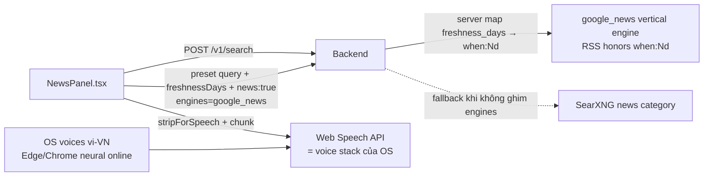

# 16 — Web UI: Tin tức đa lĩnh vực + Đọc máy tiếng Việt (TTS)

> Mục tiêu: Web UI có tab **Tin tức** duyệt tin Kinh tế vĩ mô / Tài chính–chứng
> khoán / Kinh doanh / Công nghệ–AI / Ngân hàng / Thế giới (mặc định v2.1.0 chỉ
> có tab tìm kiếm, blog, super-agent, LLM) và **đọc máy giọng tiếng Việt** cho
> tin và câu trả lời tổng hợp.

## 1. Kiến trúc

- **Không thêm endpoint backend mới**: `/v1/search` đã nhận `engines`,
  `categories`, `freshness_days` (spec `docs/06-api-spec.md` §1; routing ngữ
  cảnh liên quan FR-16). Client (`lib/api.ts`) chỉ bổ sung `freshnessDays` +
  `news` vào `SearchOptions`.
- **Cửa sổ thời gian là thật**: client chỉ gửi `freshness_days` + `news: true`
  (các param có thật của `/v1/search`); **server** map `freshness_days` →
  operator `when:{n}d` của Google News RSS ngay trong `GoogleNewsAdapter`
  (guard `\bwhen:[0-9]+[dhwmy](?![a-z0-9])` end-anchored, ASCII-only — khớp cả
  với regex JS ở toolbar — không nhân đôi operator nếu truy vấn tự do đã có
  sẵn — lookalike `when:3days` không tính là operator;
  clamp về bound của schema 3650). UI không bao giờ nhét operator của
  engine vào query nữa — cửa sổ N ngày do backend enforce và unit-test
  (`tests/test_expansion_and_digests.py` pin 8 case). Nếu truy vấn tự do tự embed
  `when:` thì toolbar nói "cửa sổ: theo when: trong truy vấn" thay vì hứa N
  ngày của preset. Probe live xác nhận
  RSS honors `when:Nd`. `news: true` → backend dùng news cache TTL (900s) và
  freshness weight cho news thay vì TTL chung 1800s.
- Tab tin tức là component riêng `frontend/components/NewsPanel.tsx`; tab hỏi
  đáp chính nhúng nút 🔊 vào `answer-header`.
- **Bảo mật link**: mọi `href` từ payload backend đi qua `safeHref()`
  (chỉ chấp nhận http/https) ở cả feed tin, trích dẫn `[n]` của câu trả lời và
  link signup của preset LLM.

## 2. Lựa chọn engine TTS (đã chốt)

| Phương án | Kết quả | Lý do chọn/không chọn |
|---|---|---|
| **Web Speech API** (browser = voice stack của OS) | ✅ **Đã chọn** | Free, không key, không dep backend, không egress từ backend MetaSearch. Windows + Edge/Chrome có sẵn giọng vi-VN (kể cả giọng neural online `vi-VN-HoaiMy*`, `vi-VN-NamMinh*` của Edge). Chính là phương án "OS API" trong yêu cầu. **Riêng tư:** giọng neural *online* của Edge gửi nội dung đọc từ trình duyệt tới dịch vụ TTS Microsoft; giọng local của OS giữ trên máy — nêu rõ cho deployments nhạy cảm. |
| `edge-tts` (Python, endpoint Microsoft free) | ⏭ Dự phòng | Chất giọng neural tốt nhưng phải thêm dep Python mới, gọi egress từ server, thêm pipeline audio (mp3/HTTP stream) — chưa cần khi Web Speech đáp ứng. |
| Windows SAPI qua PowerShell ở backend | ⏭ Không chọn | Chỉ đọc được trên máy chạy server (không phát tới trình duyệt người dùng), voice tiếng Việt phụ thuộc cài máy. |
| Google/Azure TTS API | ⏭ Không chọn | Cần key, tốn phí, thêm phụ thuộc — trái quy tắc free-first của dự án. |

**Graceful degradation**: trình duyệt không hỗ trợ → `ttsIsSupported() === false`
→ UI ẩn nút, hiện gợi ý dùng Chrome/Edge; không có giọng vi-* → vẫn đọc bằng
giọng mặc định với hint ngôn ngữ `vi-VN` (cờ được re-check mỗi lần
`voiceschanged` để không bị kẹt sai ở mount). Ghi chú riêng tư về giọng online
của Edge được hiển thị ngay trên tooltip của các nút đọc (tab Tin tức và nút
đọc câu trả lời).

## 3. Hợp đồng `lib/tts.ts`

- `ttsIsSupported()` / `ttsHasVietnameseVoice()` — phát hiện năng lực.
- `ttsOnVoicesChanged(cb) -> unsubscribe` — theo dõi danh sách giọng load bất
  đồng bộ (Chrome/Safari); dùng để re-check `ttsHasVietnameseVoice()` thay vì
  chỉ kiểm tra một lần ở mount (tránh banner "thiếu giọng vi" bị kẹt sai).
- `stripForSpeech(text)` — bỏ markdown + marker trích dẫn `[n]`; với link
  chỉ giữ **label** và bỏ URL (cả link cú pháp lẫn URL trần — giọng đọc
  không đọc được URL; link rule chạy trước citation rule nên `[12](url)`
  không để lại ngoặc thừa), khử entity phổ biến (`&amp;`…), bỏ zero-width,
  hỗ trợ URL lồng 1 ngoặc, và nhận cả bullet số `1. `. Giọng đọc đọc văn
  xuôi, không đọc cú pháp.
- `chunkForSpeech(text, maxLen=220)` — đóng gói theo câu (`.!?;:` và xuống
  dòng), câu quá dài cắt tại biên từ; `maxLen` được clamp về ≥1 (tránh loop
  vô hạn với maxLen<=0); speechSynthesis kẹt với utterance dài.
- `pickVoice` — ưu tiên giọng **nội bộ OS** (`localService=true`) hơn giọng
  online neural trong cùng tier, để nội dung đọc mặc định không rời máy;
  hết giọng nội bộ mới fallback sang online (đã ghi chú riêng tư ở tooltip).
- `ttsSpeak(text, {lang="vi-VN", rate, onStart, onEnd, onError}) -> handle` —
  đọc tuần tự từng chunk, một speaker tại một thời điểm (cancel cái đang
  chạy); `synth.speak()` được bọc try/catch để engine ném đồng bộ không làm
  kẹt state "đang đọc".
- `ttsStop()` — dừng toàn cục.

Ở lớp component (`NewsPanel`), văn bản đọc còn bỏ thẻ `[Nguồn]` đầu snippet
mà `google_news` thêm vào, strip dấu câu thừa ở cuối để không đọc "..", và
nếu thiếu title thì đọc `domain` thay vì `url` (không đọc lại "Nguồn" trùng).
`fmtWhen` clamp mốc tương lai về ngày tuyệt đối thay vì "vừa xong".

## 4. Preset tin tức (`NEWS_CATEGORIES`)

| id | Mục | Truy vấn | freshness |
|---|---|---|---|
| macro | Kinh tế vĩ mô | tin tức kinh tế vĩ mô Việt Nam GDP CPI | 3 ngày |
| finance | Tài chính – Chứng khoán | thị trường chứng khoán Việt Nam VN-Index tin tức | 2 ngày |
| business | Kinh doanh – Doanh nghiệp | tin kinh doanh doanh nghiệp Việt Nam | 3 ngày |
| tech | Công nghệ – AI | tin tức công nghệ AI phần mềm | 3 ngày |
| banking | Ngân hàng – Tiền tệ | tin tức ngân hàng lãi suất chính sách tiền tệ | 3 ngày |
| world | Kinh tế thế giới | kinh tế thế giới thị trường toàn cầu tin tức | 3 ngày |

Mỗi mục có ô truy vấn tự do ("Lọc tin"); đọc máy đọc **top 8 tin** (tiêu đề +
tóm tắt + nguồn) hoặc từng tin riêng.

## 5. Liêm chính dữ liệu hiển thị

- Mỗi tin hiển thị `domain` + mốc thời gian **lấy thẳng từ payload**
  (`published_at`/`as_of`), client không bịa thời gian; thiếu mốc → hiện
  "không rõ thời điểm". `age_s` ở response search lấy `as_of`, fallback
  `published_at` (tin tức không có `as_of`).
- TTS công khai đúng trạng thái riêng tư: `ttsVietnameseVoiceMode()` cho biết
  giọng vi-VN sẽ dùng là **local** (nội dung ở lại máy) hay **online** (gửi tới
  máy chủ TTS của vendor); toolbar và tooltip của cả 3 nút đọc (câu trả lời,
  đọc bản tin, đọc từng tin) đều ghi chú động theo mode thực tế.
- `complete === false` (engine lỗi một phần) → banner vàng "danh sách có thể
  KHÔNG đầy đủ" — phân biệt rõ với "không có tin" (FR/WP-15 contract).
- Kết quả trống → thông điệp "kết luận thật, không phải lỗi".

## 6. Kiểm thử

- Frontend: `npm run test` (vitest — chạy trong CI frontend matrix trên cả 3 OS),
  `npm run typecheck` + `npm run build`. Unit test phủ các logic thuần:
  `stripForSpeech`/`chunkForSpeech` (`lib/tts.test.ts`), `safeHref`
  (`lib/api.test.ts`). Phần map `freshness_days` → `when:Nd` được test ở
  backend (`tests/test_expansion_and_digests.py`, MockTransport — 8 case: append,
  không nhân đôi operator hợp lệ, lookalike `when:3days` vẫn append, clamp,
  freshness_days không phải số bị bỏ qua an toàn).
- TTS runtime (Web Speech API) là API trình duyệt — không unit test được ngoài
  môi trường thật; chỉ phần pure text-prep được test.
- Backend không đổi — suite đầy đủ vẫn xanh (contract snapshot không đổi).
